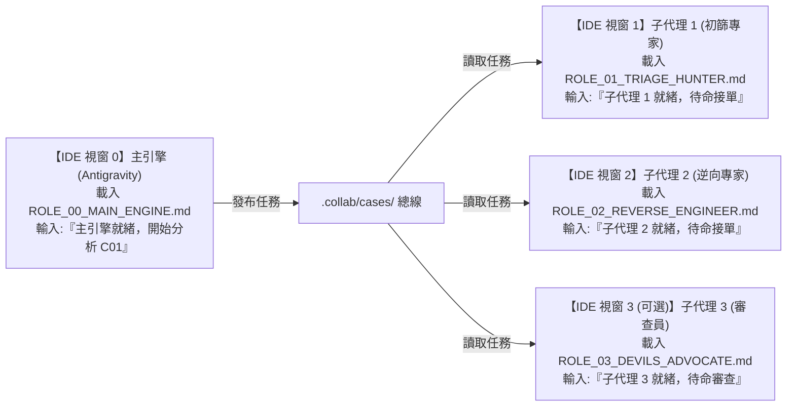

# 🌐 多 Agent Session 階層協同作戰手冊 (Hierarchical Multi-Agent Framework)

> **版本**：v2.1 (Hierarchical Main-to-Sub Engine Edition)  
> **適用場景**：HITCON Cyber Range / CTF 主機鑑識與應急響應  
> **核心設計**：以 **「主 Agent Session（主引擎總指揮）」** 為核心，透過共享/雲端同步目錄（`.collab/`）向 **「專項子代理 Sessions（初篩、逆向、審查打擊手）」** 進行任務派發、選擇題初篩、深挖連鎖與最終答案收網。

---

## 1. 核心架構：一主多從的階層代理體系

無論你是在 **單一電腦上開啟 2～3 個 AI IDE 視窗**（如 Antigravity + Cursor + Windsurf），還是**分散在 2～3 台實體主機**，整體協同架構永遠維持嚴謹的「一主多從」流水線：

```mermaid
flowchart TD
    User["你 (人類總指揮 / 最終答案提交員)"] <==> Main["【主引擎】Main Agent Session (例: Antigravity)<br/>職責：戰局總覽、拆解大題、終端實體操作、出選擇題派發任務、收成答題卡"]
    
    subgraph 共享協同總線 (.collab/cases/C01/...)
        T1["tasks/T01_Step1_Triage.md (初篩選擇題)"]
        F1["findings/F01_Step1_Triage.md (初篩結果)"]
        T2["tasks/T02_Step2_DeepDive.md (深度逆向題)"]
        F2["findings/F02_Step2_DeepDive.md (逆向成果)"]
        Q["questions.md (官方答題卡 / 綠色直接提交)"]
    end
    
    subgraph 專責子代理 Sessions (可分佈在同機不同 IDE 或跨實體電腦)
        Sub1["【子代理 1】初篩排查專家 (Sub-Agent 1)<br/>專門在龐大日誌/進程樹中做特徵比對，回答選擇題 A/B/C"]
        Sub2["【子代理 2】代碼逆向/解密專家 (Sub-Agent 2)<br/>接過子代理 1 的產出，專門處理混淆腳本、反編譯、萃取 C2"]
        Sub3["【子代理 3】批判審查員 (Devil's Advocate)<br/>專門找碴，查驗是否為正常微軟系統行為，剔除假警報"]
    end

    Main -->|1. 拆解大題，發布初篩選擇題| T1
    T1 -->|2. 接單分析| Sub1
    Sub1 -->|3. 回覆初篩選項 A/B/C| F1
    F1 -->|4. 主引擎讀取，確認破局點| Main
    
    Main -->|5. 組織第二棒，發布深挖任務| T2
    T2 -->|6. 接單逆向| Sub2
    Sub2 -->|7. 解出明文 C2 與 Payload| F2
    F2 -->|8. 主引擎格式審查，填寫答題卡| Q
    Q -.->|9. 冒出綠色答案，複製送出得分| User
```

---

## 2. 角色分工矩陣 (Who Does What)

| 代理人角色 | 建議 IDE / 模型配備 | 核心職責 | 絕不負責的事項 |
| :--- | :--- | :--- | :--- |
| **主引擎大腦 (Main Agent)** | 具備完整終端命令執行與檔案權限的 IDE（如 **Antigravity**） | 1. 閱讀題目背景，制定大局假說<br/>2. 執行實體取證工具（Volatility、Zimmerman）<br/>3. 將複雜題目切碎，向子代理出選擇題<br/>4. 彙整情報，填寫 `questions.md` | 不陷入單一函式的瑣碎去混淆（交給子代理代工） |
| **子代理 1 (初篩專家)** | 適合長文本過濾的模型（如 **Claude 3.7 / Gemini 2.5**） | 1. 快速檢索幾萬行事件日誌與進程樹<br/>2. 回答主引擎給予的多選一選擇題<br/>3. 指出最可疑的 1~2 個異常 PID 或檔名 | 不直接碰實體終端，不擅自更改答題卡 |
| **子代理 2 (逆向專家)** | 擅長代碼解構與邏輯推理（如 **Cursor / Windsurf / GPT-4o**） | 1. 深度分析混淆的 PowerShell / VBS / Base64<br/>2. 反編譯二進位檔案結構，萃取 C2 URL 與 Hash | 不直接碰實體終端，不擅自更改答題卡 |
| **人類選手 (你)** | **總裁決官 & 得分提交員** | 1. 在各視窗之間貼上一鍵觸發指令<br/>2. 觀看 `questions.md`，看到綠色答案直接複製去平台送出得分！ | 不需要背繁雜鑑識指令，不需要自己下高難度假說 |

---

## 3. 連鎖調度作戰三步法 (Chain-of-Agents Operational Workflow)

主引擎與子代理之間，依照以下「出題 ➡️ 作答 ➡️ 轉傳 ➡️ 深挖 ➡️ 結案」的三步標準流水線推進：

### 步驟一：主引擎拆題，向「子代理 1」出選擇題（初篩）
1. **主引擎動作**：
   - 主引擎在本機跑完初步掃描（如 Volatility `psscan` + `malfind`）。
   - 主引擎在 `cases/C01/tasks/` 建立 `T01_sub1_triage.md`：
   > **【主引擎派發給 子代理 1】**：  
   > *「在記憶體中掃描到以下三個疑似進程：  
   > - `[A] PID 5896 oneetx.exe` (位於 Temp 目錄)  
   > - `[B] PID 1024 svchost.exe` (無異常連線)  
   > - `[C] PID 3312 explorer.exe` (標準桌面行程)  
   > 請子代理 1 依附帶的 VAD 屬性與記憶體特徵，**判定哪一個最具有代碼注入惡意特徵（單選題），並說明理由**。」*
2. **人類動作**：切換到子代理 1 視窗，貼上 `@.collab/cases/C01/tasks/ 處理最新任務`。
3. **子代理 1 輸出**：在 `findings/F01_sub1_triage.md` 回應：
   > *「**選 [A] PID 5896**。因為該進程 VAD 屬性為 `PAGE_EXECUTE_READWRITE`，且記憶體前兩個 bytes 為 `MZ` 標頭，其餘兩者皆為常規 Windows 正常行為。」*

### 步驟二：主引擎吸收成果，組裝第二棒，向「子代理 2」出深挖題（逆向）
1. **主引擎動作**：
   - 主引擎讀取 `F01`，鎖定核心攻擊點為 **PID 5896**。
   - 主引擎在本地終端機執行 dump，將 PID 5896 的 strings 與 PE 導出。
   - 主引擎在 `tasks/` 建立 `T02_sub2_reverse.md`：
   > **【主引擎派發給 子代理 2】**：  
   > *「子代理 1 已鎖定 PID 5896。我已抽出該進程的 strings 片段（見附錄）。請子代理 2 進行代碼去混淆與分析，**回答以下兩小題：(1) 原始檔案名稱為何？(2) 連線的 C2 伺服器 IP 與完整 URL 為何？**」*
2. **人類動作**：切換到子代理 2 視窗，貼上 `@.collab/cases/C01/tasks/ 處理最新任務`。
3. **子代理 2 輸出**：在 `findings/F02_sub2_reverse.md` 回應：
   > *「(1) 原始檔名為 `Piperazine.exe`。<br/>(2) C2 IP 為 `77.91.124.20:80`，完整請求 URL 為 `http://77.91.124.20/store/games/index.php`。」*

### 步驟三：主引擎收網核驗，填入最終答題卡（結案得分）
1. **主引擎動作**：
   - 讀回子代理 2 的精確成果。
   - 進行時區（UTC）與格式自檢，自動填入 `cases/C01/questions.md`：
     - `Q02 (惡意進程) -> oneetx.exe (PID 5896) [x] 已解出`
     - `Q08 (原始名稱) -> Piperazine.exe [x] 已解出`
     - `Q09 (C2 連線) -> 77.91.124.20:80 [x] 已解出`
     - `Q10 (請求 URL) -> http://77.91.124.20/store/games/index.php [x] 已解出`
   - 主引擎向你彈出通知：*「C01 的 Q02、Q08、Q09、Q10 已全數搞定，請看 questions.md 複製答案！」*
2. **人類動作**：直接複製答案貼上比賽平台，拿下分數！

---

## 4. 雲端硬碟運作安全三大鐵律（防呆必守）

1. **鐵律 1：大檔留在本機 SSD，雲端硬碟只同步「純文字情報」**：
   - 10GB+ 的原始 E01、Memory Dump 放在本地硬碟，**嚴禁**搬進 `.collab/`。
   - `.collab/` 只放 Markdown、CSV、JSON，檔案幾十 KB，雲端硬碟秒級同步，絕不卡頻寬。
2. **鐵律 2：單一主引擎寫入原則 (Single Orchestrator)**：
   - 答題卡 `questions.md` 與記分板 `SCOREBOARD.md` **只能由主引擎修改**。
   - 子代理**只能寫入** `findings/`，絕對不可直接搶改 `questions.md`，彻底消滅雲端硬碟的「衝突副本（Conflict Copy）」！
3. **鐵律 3：極簡通用指令（One-Liner Execution）**：
   - 人類在切換子代理視窗時，不需要敲打長篇大論，永遠使用同一句標準咒語：
   > **`@.collab/ 讀取當前大題 tasks/ 內最新任務，分析並輸出至對應 findings/`**

---

## 5. 賽前啟動與角色認領 SOP (How to Bootstrap Roles)

在比賽開始或開啟各個 AI IDE 視窗時，按照以下極簡 SOP 快速完成「角色載入與待命」：



### 具體操作步驟：
1. **視窗 0 (主引擎 - 例如 Antigravity)**：
   - 傳送提示詞：`請閱讀 .collab/roles/ROLE_00_MAIN_ENGINE.md，擔任主引擎領航員，準備攻堅 C01 大題。`
   - 主引擎啟動，初始化環境並開始拆解任務。
2. **視窗 1 (子代理 1 - 例如 Cursor / Claude)**：
   - 傳送提示詞：`請閱讀 .collab/roles/ROLE_01_TRIAGE_HUNTER.md，擔任初篩排查專家。回覆確認就緒。`
   - 子代理 1 回覆：「子代理 1 就緒，待命接單」，原地待命。
3. **視窗 2 (子代理 2 - 例如 Windsurf / Cursor)**：
   - 傳送提示詞：`請閱讀 .collab/roles/ROLE_02_REVERSE_ENGINEER.md，擔任代碼逆向專家。回覆確認就緒。`
   - 子代理 2 回覆：「子代理 2 就緒，待命接單」，原地待命。
4. **開跑作戰**：
   - 主引擎一在 `tasks/` 產出任務，你只要在子代理視窗輸入：
   > **`@.collab/ 讀取當前大題 tasks/ 內最新任務，分析並輸出至對應 findings/`**
   - 整個集群便會如精密齒輪般自動咬合運轉！

