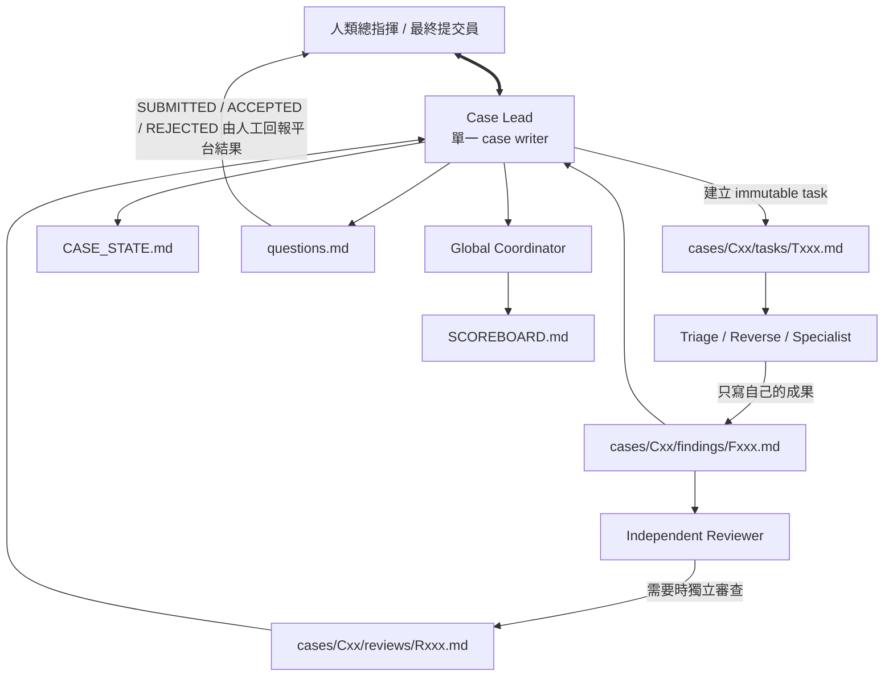
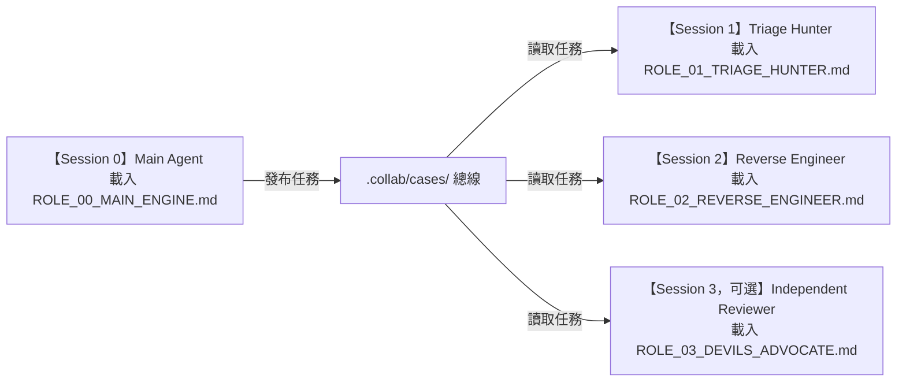

# 🌐 多 Agent Session 階層協同作戰手冊 (Hierarchical Multi-Agent Framework)

> **版本**：v2.2 (Governed Case Bus Edition)
> **適用場景**：HITCON Cyber Range / CTF 主機鑑識與應急響應  
> **核心設計**：以 **case-centric、single-writer、evidence-first** 為核心；`.collab/cases/` 是唯一協作總線。每個 case 只有一個 Lead Session，專項 Session 回傳 finding/review；另由一個 Global Coordinator 維護全域 scoreboard。

---

## 1. 核心架構：一主多從的階層代理體系

無論是在單機多 Session 或跨實體主機執行，協作都只透過 `cases/<CaseID>/tasks/`、`findings/`、`reviews/` 交換文字工件；不再維護第二套 inbox/outbox。

---

## 2. 角色分工矩陣 (Who Does What)

| 代理人角色 | 能力需求 | 核心職責 | 寫入邊界 |
| :--- | :--- | :--- | :--- |
| **Main Agent / Case Lead** | 全局推理、終端操作、工件整合 | 對被指派 case 拆題、建立 task、彙整 finding/review、維護答案生命週期 | 只寫自己 case 的 `CASE_STATE.md`、`questions.md`、`tasks/`；若兼任 Global Coordinator 才寫 `SCOREBOARD.md` |
| **Triage Hunter** | 長文本檢索、異常篩選、快速 evidence triage | DISCOVERY / TRIAGE / VERIFY 任務；允許指出題目候選集合之外的新線索 | 只寫自己對應的 `findings/` |
| **Reverse Engineer** | 程式碼推理、去混淆、二進位分析 | REVERSE 任務；還原邏輯並提供可重現證據 | 只寫自己對應的 `findings/` |
| **Independent Reviewer** | 獨立驗證、反例與 false-positive 排除 | REVIEW 任務；檢查證據、因果、格式與替代解釋 | 只寫自己對應的 `reviews/` |
| **人類選手** | 平台互動與最終裁決 | 實際提交答案，將平台 ACCEPTED / REJECTED 結果回報 Main | 不直接改協作狀態檔，避免多 writer |

---

## 3. 任務與答案生命週期

### Task Types
- `DISCOVERY`：開放式探索；不得限制 Worker 只能從預設候選中選答案。
- `TRIAGE`：快速縮小範圍並列出可疑標的與證據。
- `VERIFY`：驗證既有候選；可使用 A/B/C，但 Worker 必須能回報「皆非」。
- `REVERSE`：去混淆、逆向、解碼、結構還原。
- `REVIEW`：由獨立 Session 檢查 finding、替代解釋與反證。

### Task contract
1. Main 建立 `tasks/Txxx_<type>_<slug>.md` 後視為 **immutable**；Worker 不修改 task 狀態或內容。
2. Task 以 `target_role` 描述能力，以 `assignee_session` 指向**一個具體 Session**；不允許多 Session 同時把同一 task 視為自己的工作。
3. Worker 僅新增自己的 `findings/Fxxx_*.md`；Reviewer 僅新增自己的 `reviews/Rxxx_*.md`。
4. Case Lead 讀取成果後，唯一負責更新該 case 的 `CASE_STATE.md` 與 `questions.md`；Global Coordinator 根據各 Lead 回報唯一更新 `SCOREBOARD.md`。

### Answer lifecycle
`OPEN → CANDIDATE → VERIFIED → SUBMITTED → ACCEPTED | REJECTED`

- `OPEN`：尚無候選答案。
- `CANDIDATE`：已有答案，但 evidence contract 尚未滿足。
- `VERIFIED`：證據可重現、格式已檢查，Main 判定可提交；**不代表平台已接受**。
- `SUBMITTED`：人類已提交，等待平台結果。
- `ACCEPTED`：平台明確判定正確；只有此狀態計入 scoreboard 已解題數。
- `REJECTED`：平台明確判定錯誤；保留歷史 evidence，回到新一輪調查。

---

## 4. 協作安全與證據鐵律

1. **鐵律 1：大檔留在本機 SSD，雲端硬碟只同步「純文字情報」**：
   - 10GB+ 的原始 E01、Memory Dump 放在本地硬碟，**嚴禁**搬進 `.collab/`。
   - `.collab/` 只放 Markdown、CSV、JSON，檔案幾十 KB，雲端硬碟秒級同步，絕不卡頻寬。
2. **鐵律 2：每個檔案只有一個 Writer**：
   - Case Lead only：自己 case 的 `CASE_STATE.md`、`questions.md`、`tasks/`。
   - Global Coordinator only：`SCOREBOARD.md`。
   - Worker only：自己被指派 task 對應的 `findings/`。
   - Reviewer only：自己被指派 review 對應的 `reviews/`。
   - 任務一旦發布即不可由 Worker 原地改狀態，避免同步衝突與 provenance 被覆寫。
3. **鐵律 3：Evidence before confidence**：
   - 每個候選答案至少要記錄 artifact/source、取得方法、直接 observation、重現步驟與已知限制。
   - `confidence` 只能摘要證據強度，不可取代 evidence；「模型覺得很像」不是證據。
4. **鐵律 4：Secrets 不進 Git**：
   - 真實密碼、token、session secret、private key 不得寫入 tracked `.collab` 檔案。
   - 需要跨 Session 暫存時只使用 Git 忽略的 `.collab/runtime/`，並在 tracked finding/questions 中以 `[REDACTED: runtime ref]` 指向。
   - CTF 公開 flag 或題目專用、賽後失效的 credential 是否公開，仍由人類選手決定；預設視為 secret。
5. **鐵律 5：極簡通用指令（One-Liner Execution）**：
   - 人類在切換子代理視窗時，不需要敲打長篇大論，永遠使用同一句標準咒語：
   > **`@.collab/ 讀取指派給本 Session 的 task ID，分析並輸出至對應 findings/ 或 reviews/`**

---

## 5. 賽前啟動與角色認領 SOP (How to Bootstrap Roles)

在比賽開始或開啟各個 AI Session 時，按照以下極簡 SOP 快速完成角色載入與待命：

### 具體操作步驟：
1. **Session 0 (Main Agent)**：
   - 傳送提示詞：`請閱讀 .collab/roles/ROLE_00_MAIN_ENGINE.md，擔任主引擎領航員，準備攻堅 C01 大題。`
   - 主引擎啟動，初始化環境並開始拆解任務。
2. **Session 1 (Triage Hunter)**：
   - 傳送提示詞：`請閱讀 .collab/roles/ROLE_01_TRIAGE_HUNTER.md，擔任初篩排查專家。回覆確認就緒。`
   - 子代理 1 回覆：「子代理 1 就緒，待命接單」，原地待命。
3. **Session 2 (Reverse Engineer)**：
   - 傳送提示詞：`請閱讀 .collab/roles/ROLE_02_REVERSE_ENGINEER.md，擔任代碼逆向專家。回覆確認就緒。`
   - 子代理 2 回覆：「子代理 2 就緒，待命接單」，原地待命。
4. **開跑作戰**：
   - 主引擎一在 `tasks/` 產出任務，你只要在子代理視窗輸入：
   > **`@.collab/ 讀取指派給本 Session 的 task ID，分析並輸出至對應 findings/ 或 reviews/`**
   - Session 只能處理 `assignee_session` 明確指向自己的 task；不要以「未認領」或「最新檔案」自行搶單，避免重複分析與同步競態。
