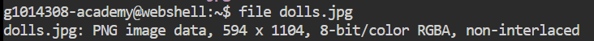
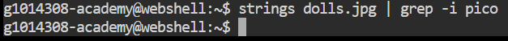
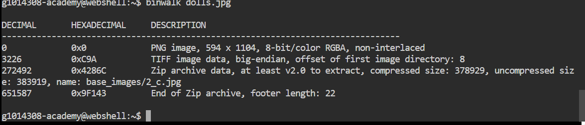
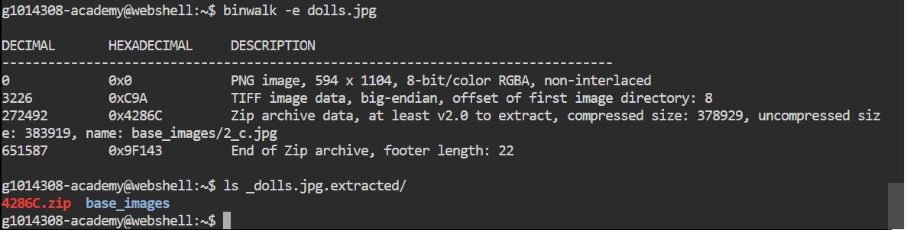
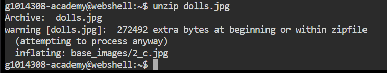
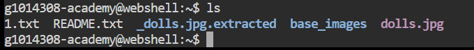
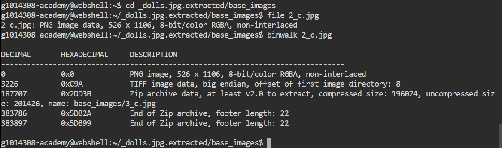
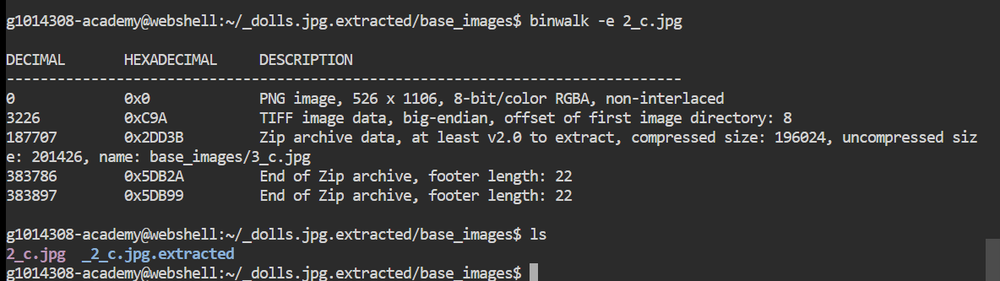

# 一個檔案真正是什麼、藏了什麼

## 為什麼要上這一堂

前兩次實作（A1 的 CVE、A3 的 Metasploitable2）都是主動出手：掃一台機器、找到弱點、拿到 shell。這一堂反過來：對象是一個已經在你手上的檔案，而且不能執行它。

Lesson 3 講惡意程式時提到，攻擊者會把要用的東西藏起來：程式裡的字串、附在另一個檔案尾巴的檔案、塗黑之後其實還在的文字。共同點是「畫面上看不到，位元組裡還在」。鑑識（forensics）就是只看位元組、把藏的東西找出來。不執行有兩個理由：不明檔案可能就是惡意程式，打開等於中招；而且執行會改變它，之後就說不清它原本長什麼樣。

這堂要學會五件事：不看副檔名判斷檔案真正的格式；把檔案裡的明文和中繼資料抽出來；找出並拆出藏在檔案裡的另一個檔案；知道圖片像素裡也能藏資料；讀懂一個檔頭，判斷它有沒有被改過。

## 這堂用哪幾題

這堂用 CyLab 上的五題，全部選 Medium。Easy 的題目大多一個指令就解完，碰不到「下一步該用什麼工具」這個問題，而那正是這堂要練的；你們在前兩次作業已經自己拿過 shell，做 Medium 不會太難。

| 題目 | 角色 | 題目怎麼說 |
|---|---|---|
| Matryoshka doll | 課堂帶練 | 俄羅斯娃娃一個套一個，最裡面那個是什麼？提示問：檔案裡可以藏檔案？要怎麼找？ |
| File types | 作業 | 一份標示機密的檔案，我的 PDF 閱讀器打不開，也許你的可以。提示：有些格式可以把別的檔案包在裡面 |
| St3g0 | 作業 | 下載這張圖，找出 flag。提示：訊息結尾會是 `$t3g0` |
| tunn3l v1s10n | 作業 | 我們找到這個檔案，把 flag 找回來。提示：奇怪，它顯示不出來 |
| like1000 | 加分 | 這個 tar 被 tar 了很多次。提示：寫個腳本，不然會做到天荒地老 |

五題問的都是同一個問題：東西藏在哪一層？每一題的說明和提示都已經在暗示答案，而且一題比一題深。課堂示範只走最淺的兩層，作業三題各往下一層，往哪一層請自己從說明推，那是作業的第一個問題。所以示範教的是一套拿到任何不明檔案都照走的順序，不是某一題的解法；作業用同一套順序走到更深的地方。

## 先把題目檔案弄進 terminal

CyLab 自帶的 terminal（webshell）已經有這堂要的全部工具，不用安裝（用自己的 Linux 也行，安裝指令在講義最後）。題目檔案直接在 webshell 裡下載：

1. 題目頁上有檔案的下載連結（例如 `dolls.jpg`）。在連結上按右鍵，選「複製連結網址」，**不要**左鍵點開，那會下載到你的電腦。
2. 回到 webshell，打 `wget`、一個空白，貼上網址，按 Enter：

   ```bash
   wget https://…/dolls.jpg
   ```

   最後一行會寫 `'dolls.jpg' saved`。
3. `ls -l` 確認檔案在、大小合理。

webshell 的家目錄只有 128 MB，拆完的中間檔要隨手刪。它也沒有畫面，需要看圖的那一步（後面會說）要把檔案拿回自己電腦做。

---

## 從題目說明開始：Matryoshka doll

題目說：俄羅斯娃娃是一組大小遞減、一個套一個的木娃娃，最裡面那個是什麼？提示問：檔案裡可以藏檔案？那要怎麼找？

題目和提示已經把要做的事說完了：有一個檔案裡面藏著檔案，而且不只一層；剩下的問題只有「怎麼找」。下載下來的檔案叫 `dolls.jpg`。

### 步驟 1 辨識：它真的是 jpg 嗎

檔名是人取的，副檔名改成什麼都可以，所以先不要打開它，先問它到底是什麼：

```bash
file dolls.jpg
```
```text
dolls.jpg: PNG image data, 594 x 1104, 8-bit/color RGBA, non-interlaced
```



冒號後面第一個詞就是答案：PNG，而不是副檔名說的 JPEG。後面是它順便讀出的檔頭欄位：594 x 1104 是寬高，8-bit/color RGBA 是每個像素四個通道、各 8 位元，non-interlaced 是像素的儲存順序。現在只需要第一個詞，寬高留著，等一下對 `exiftool` 和 `binwalk` 的輸出時會用到。

`file` 不看檔名，只比對檔案開頭的幾個位元組（magic bytes，每種格式固定的開頭）：PNG 開頭固定是 `89 50 4E 47`，zip 是 `50 4B`（`PK`），PDF 是 `25 50 44 46`（`%PDF`）。副檔名可以隨便改，開頭的位元組改了檔案就壞，所以 `file` 信的是後者。

`file` 有兩種回答要記得怎麼處理：回報一個你沒想到的格式（例如 `.pdf` 卻說是 `shell archive text`），那就是它真正的格式，用對應的工具開；回報 `data`，表示開頭的位元組跟任何已知格式都對不上，常見原因是檔頭被改壞了，作業裡會碰到。

### 步驟 2 看明文：有沒有直接看得到的東西

知道是 PNG 之後，先做兩個最快的檢查：檔案裡有沒有可讀的字串、中繼資料有沒有說什麼。

```bash
strings dolls.jpg | grep -i pico
```



沒有任何輸出。`strings` 把檔案裡連續 4 個以上的可印字元列出來，`grep -i pico` 只留下含 pico 的那些行（`-i` 不分大小寫）；一行都沒有，表示 flag 沒有用明文放在檔案裡。

```bash
exiftool dolls.jpg
```
```text
ExifTool Version Number         : 12.40
File Name                       : dolls.jpg
File Size                       : 636 KiB
...
File Type                       : PNG
File Type Extension             : png
MIME Type                       : image/png
Image Width                     : 594
Image Height                    : 1104
...
Profile Description             : Display
...
User Comment                    : Screenshot
...
Warning                         : [minor] Trailer data after PNG IEND chunk
Image Size                      : 594x1104
Megapixels                      : 0.656
```

`exiftool` 讀中繼資料（metadata，描述檔案本身的資料：尺寸、相機、作者、時間）。完整輸出有一百多行，其中大半是 Profile 開頭的色彩描述檔（截圖時螢幕的顏色設定，連各國語言的「彩色 LCD」都在），跟藏東西無關，上面用 `...` 略過。要看的只有四種行：

- File Type 寫 PNG，跟 `file` 的答案一致。
- Image Width、Image Height 是 594、1104，也跟 `file` 一致。
- User Comment 寫 Screenshot，說明這張圖是截圖來的。這一行是作者可以自由填的欄位，有些題目把 flag 直接放在這裡。
- Warning 那一行才是重點。

PNG 以 `IEND` 這個區塊結尾，後面照理不該有東西。這行的意思是：檔案在圖片結束之後還有資料。提示問的「檔案裡藏檔案」，看來就在尾巴。以後跑 `exiftool` 可以先只看這幾行：`exiftool x | grep -iE "warning|comment|type"`。

### 步驟 3 拆：圖片結束之後是什麼

`binwalk` 會掃整個檔案，把它認得的每一種格式和出現的位置（offset，距離檔案開頭的位元組數）列出來：

```bash
binwalk dolls.jpg
```

```text
DECIMAL       HEXADECIMAL     DESCRIPTION
--------------------------------------------------------------------------------
0             0x0             PNG image, 594 x 1104, 8-bit/color RGBA, non-interlaced
3226          0xC9A           TIFF image data, big-endian, offset of first image directory: 8
272492        0x4286C         Zip archive data, at least v2.0 to extract, compressed size: 378929, uncompressed size: 383919, name: base_images/2_c.jpg
651587        0x9F143         End of Zip archive, footer length: 22
```



先看表頭。三個欄位：DECIMAL 和 HEXADECIMAL 是同一個位置（offset）的十進位和十六進位寫法，十六進位那個等一下會變成拆出來的檔名、也是十六進位編輯器裡看到的位址；DESCRIPTION 是它在那個位置認出了什麼。每一列就是「在第幾個位元組，看到什麼格式的開頭」。

四列各是什麼：

- 第一列是圖片本身，跟 `file` 說的一樣。
- 第二列的 TIFF 其實是 PNG 裡的 EXIF 區塊（`exiftool` 列出的那些欄位就存在這裡），不用理。
- 第三列才是重點：從第 272492 個位元組開始，有一個 zip，壓縮後 378929、解開 383919 個位元組，裡面有一個叫 `base_images/2_c.jpg` 的檔案。
- 第四列是 zip 的結尾標記，在 651587；加上 22 個位元組的結尾就是 651609，正好是整個檔案的大小（`exiftool` 說的 636 KiB）。所以這個 zip 從 272492 一路接到檔案最後。

把它拆出來有三種做法，結果相同，**擇一即可**：

| 做法 | 指令 | 差別 |
|---|---|---|
| A `binwalk -e` | `binwalk -e dolls.jpg` | 只拆這一層，拆出來的東西放在 `_dolls.jpg.extracted/` |
| B `unzip` | `unzip dolls.jpg` | 不靠 binwalk。zip 的目錄在檔案尾端，所以直接解得開，只是它會先抱怨前面多了 272492 個位元組；解開的東西放在目前目錄的 `base_images/` |
| C `binwalk -e -M` | `binwalk -e -M dolls.jpg` | `-M`（matryoshka）自動對拆出來的檔案再拆，一行做完所有層 |

A 和 B 其實是同一件事。`binwalk` 自己不壓縮、也不解壓縮，它只找簽名；`-e` 是它認出 zip 之後替你呼叫解壓工具去拆，認出 gzip 就用 gzip 的解法、認出 tar 就用 tar 的。所以它認得的格式比它拆得動的多：系統沒裝對應工具的格式，`-e` 會列出那一行，卻什麼都拆不出來，也不太會報錯。這就是後面那張解壓表存在的原因：拆不動時，照 `file` 的回答自己挑工具。

下面用做法 A 走，才看得到每一層的 `file` 和 `binwalk` 在說什麼；做法 C 留到你確定裡面是什麼之後再用。

```bash
binwalk -e dolls.jpg
ls _dolls.jpg.extracted/
```

```text
4286C.zip  base_images
```



目錄裡有 `4286C.zip`（用剛才那個 offset 的十六進位命名）和已經解開的 `base_images/2_c.jpg`。做法 B 的輸出長這樣：

```text
Archive:  dolls.jpg
warning [dolls.jpg]:  272492 extra bytes at beginning or within zipfile
  (attempting to process anyway)
  inflating: base_images/2_c.jpg
```



警告說的 272492 就是 binwalk 找到的那個 offset：zip 之前的 272492 個位元組是 PNG，`unzip` 不認識它們、跳過，照樣把 `base_images/2_c.jpg` 解到目前目錄。



### 回到步驟 1：拆出來的檔案，再從頭檢查一次

`2_c.jpg` 跟剛才的 `dolls.jpg` 一樣，檔名不可信、內容不知道，所以從頭再做一次：

```bash
cd _dolls.jpg.extracted/base_images
file 2_c.jpg
binwalk 2_c.jpg
```
```text
2_c.jpg: PNG image data, 526 x 1106, 8-bit/color RGBA, non-interlaced

DECIMAL       HEXADECIMAL     DESCRIPTION
--------------------------------------------------------------------------------
0             0x0             PNG image, 526 x 1106, 8-bit/color RGBA, non-interlaced
3226          0xC9A           TIFF image data, big-endian, offset of first image directory: 8
187707        0x2DD3B         Zip archive data, at least v2.0 to extract, compressed size: 196024, uncompressed size: 201426, name: base_images/3_c.jpg
383786        0x5DB2A         End of Zip archive, footer length: 22
383897        0x5DB99         End of Zip archive, footer length: 22
```



跟第一層同一個樣子：又是一張 PNG，尺寸換了（526 x 1106），尾巴又接著一個 zip，這次在 187707，裡面是 `base_images/3_c.jpg`。

多了一列要解釋：zip 結尾標記出現兩次。真正屬於這一層的是最後一列，383897 加 22 等於 383919，正好是第一層列出的 uncompressed size，也就是 `2_c.jpg` 的大小。383786 那一列多半是再裡面一層的 zip 露出來的痕跡：圖片資料壓不太動，壓縮時大段照原樣存，裡面那個 zip 的結尾簽名就這樣被 binwalk 掃到。這是 binwalk 的常態，它只認簽名、不驗證，所以列出來的東西要拿數字互相對，對得上的才算。

再拆、再回頭：

```bash
binwalk -e 2_c.jpg
ls
```
```text
2_c.jpg  _2_c.jpg.extracted
```



第三層在 `_2_c.jpg.extracted/base_images/3_c.jpg`，同樣三步再跑一次，拆出 `4_c.jpg`；第四層拆出來的不再是圖片，而是 `flag.txt`，這就是最裡面的娃娃：

```bash
cat flag.txt
```

```text
p i c o C T F { . . . }
```

字元之間夾著空白，去掉就是 flag。四層都是步驟 1 → 2 → 3 再回頭，做法 C 就是把這個迴圈交給 binwalk 自動跑。

### 整個 dolls.jpg 長什麼樣

把剛才每一層的 `binwalk` 數字疊起來，就是這個檔案的全貌。每一層都是「一張完整的 PNG，IEND 之後接一個 zip，zip 裡是下一層」：

```text
dolls.jpg（651609 bytes）
│
├─ 0        PNG 594×1104 ……………… IEND        ← 圖片本身，看圖軟體只畫到這裡
└─ 272492   zip ─── base_images/2_c.jpg（383919 bytes）
             │
             ├─ 0        PNG 526×1106 ……… IEND
             └─ 187707   zip ─── base_images/3_c.jpg（201426 bytes）
                          │
                          ├─ PNG ……………………… IEND
                          └─ zip ─── base_images/4_c.jpg
                                       │
                                       ├─ PNG ……………………… IEND
                                       └─ zip ─── flag.txt   ← 最裡面的娃娃
```

前兩層的 offset 和大小是上面 `binwalk` 列出的；第三、四層的數字請你自己拆到那裡時填上。看圖軟體每一層都只畫 PNG 的部分，IEND 之後的 zip 對它來說不存在，所以四張圖看起來都是正常的圖片。

### 回頭看：剛才做的事排起來就是一張表

| 步驟 | 問題 | 指令 | Matryoshka doll |
|---|---|---|---|
| 1 辨識 | 這到底是什麼格式？ | `file x` | `.jpg` 其實是 PNG |
| 2 看明文 | 有沒有直接可讀的字串、中繼資料？ | `strings x \| grep -i pico`、`exiftool x` | 警告 IEND 後面有東西 |
| 3 拆 | 裡面有沒有藏另一個檔案？拆出來後**回到步驟 1** | `binwalk x`、`binwalk -e x` | 尾巴的 zip，四層 |
| 4 看像素 | （圖片）像素的最低位元有沒有資料？ | `zsteg x.png` | 沒用到 |
| 5 修檔頭 | 認不出來、打不開？檔頭欄位對不對？ | `xxd x \| head` | 沒用到 |

這張表就是這堂要學會的東西。順序是從快而通用的，到慢而專門的：`file` 一秒鐘就有答案，而且後面每一步都靠它決定用什麼工具，所以一定最先；`strings`、`exiftool` 幾乎不花時間；`binwalk` 可能要一層層遞迴；`zsteg` 只對圖片有意義；檔頭要自己讀、自己算。前三步每個檔案都要跑，Matryoshka doll 在第三步就結束了；4 和 5 是前三步都沒有收穫時才往下走，作業有兩題會走到那裡。

為什麼不能只用一個工具？因為每種藏法只有特定工具看得到：`strings` 看不到壓縮過或嵌進去的檔案，`binwalk` 看不到像素裡的位元，`zsteg` 看不到壞掉的檔頭。單一工具沒結果不代表沒東西，只有照順序跑完才能說「這裡沒有」。

那為什麼不一開始就 `binwalk`？這一題確實可以：`binwalk -e -M dolls.jpg` 一行就到 flag。但 `binwalk` 只回答一種問題：裡面有沒有它認得的格式。檔頭壞掉的檔案它列不出有用的東西，`file` 回報 `data` 才是線索；flag 直接寫在中繼資料或明文裡的檔案它一行都不會提，`strings`、`exiftool` 兩秒鐘就看到。而且它的輸出要靠 `file` 的答案來讀：剛才那行 TIFF 是誤判，知道這是 PNG 才知道那是 EXIF 區塊、不用理。先跑 `file` 和 `exiftool`，看到 IEND 之後還有資料的警告，再跑 `binwalk`，拆是有證據的，不是反射動作。

---

## 作業會碰到、示範沒碰到的

### 第三步的格式不只 zip

Matryoshka doll 四層都是 zip，但「辨識 → 拆 → 回頭」的迴圈不限於 zip，每一層可以是不同的壓縮或封裝格式。遇到不熟的格式，照 `file` 的回答查對應的解壓工具：

| `file` 回報 | 工具 |
|---|---|
| Zip archive data | `unzip` |
| shell archive text | `sh 檔名` |
| current ar archive | `ar x 檔名` |
| cpio archive | `cpio -idv < 檔名`（`<` 不能省，否則它會把檔名當成搜尋樣式、停在那裡等輸入）；webshell 沒有 `cpio`，改用 `7z x 檔名` |
| bzip2 / gzip / XZ compressed data | `bzip2 -d`、`gzip -d`、`xz -d` |
| lzip / LZ4 / LZMA / lzop compressed data | `lzip -d`、`lz4 -d`、`lzma -d`、`lzop -d` |
| ASCII text，但內容像 `7069636f...` | 十六進位，`xxd -r -p` 還原 |

其中 `lzma`、`lzop`、`xz` 會看副檔名決定要不要處理，拆出來的檔案沒有副檔名時，先 `mv` 成對應的 `.lzma`、`.lzo`、`.xz`。

### 第四步：像素裡的資料

有一種圖，前三步都不會有收穫：`file` 說是正常的 PNG，`strings`、`exiftool` 沒東西，`binwalk` 只看到圖片本身。結構全部正常，那資料只能在像素裡。

一個像素的每個顏色值佔 8 個位元，把最低的那一個位元（LSB，least significant bit）改掉，顏色只差 1/256，肉眼看不出來；一張圖有幾十萬個像素，就能藏不少資料。這種藏法前三步全都看不到，因為圖片的結構完全正常。

`zsteg` 專門對 PNG 和 BMP 做這件事，它會把各種「哪個通道、哪個位元、什麼順序」的組合都試一遍，列出看起來像文字或檔案的結果：

```bash
zsteg x.png
```

```text
b1,rgb,lsb,xy       .. text: "..."
b1,abgr,msb,xy      .. file: PGP Secret Sub-key
```

每一行前面是組合：`b1` 取 1 個位元、`rgb` 依 R、G、B 三個通道交錯、`lsb` 取最低位元、`xy` 逐列掃。後面是用那個組合讀出來的東西。列出來的大多是雜訊（像那行 PGP），要找的是有意義的文字；題目若有給訊息的開頭或結尾，就用它來確認。確定某一組合之後，`zsteg -E b1,rgb,lsb,xy x.png` 只輸出那一組。

### 第五步：讀檔頭

檔案打不開、`file` 又回報 `data`，也就是認不出格式，通常是檔頭（header，檔案開頭描述結構的固定欄位）有欄位被改了。用 `xxd` 看前幾行：

```bash
xxd -g 1 x | head
```

以 BMP 為例，前 54 個位元組是檔頭，欄位位置固定；數值用小端序（little-endian）存，也就是低位元組在前，`36 00 00 00` 代表 0x36 = 54：

| offset | 長度 | 欄位 | 正常值 |
|---|---|---|---|
| 0x00 | 2 | 識別字 | `42 4D`（`BM`）|
| 0x02 | 4 | 整個檔案的大小 | 等於實際檔案大小 |
| 0x0A | 4 | 像素資料從哪裡開始 | 54（0x36）|
| 0x0E | 4 | 第二段檔頭的大小 | 40（0x28）|
| 0x12 | 4 | 寬 | |
| 0x16 | 4 | 高 | |
| 0x1A | 2 | 色彩平面數 | 1 |
| 0x1C | 2 | 每像素位元數 | 24 |

檢查方法是拿欄位互相對：每一列像素佔「寬 × 每像素位元組數」再補到 4 的倍數，「檔案大小 − 54」除以每列的位元組數，就是這張圖實際有幾列。算出來的值跟高度欄位不一樣，就是有人改過高度。BMP 的像素資料是**從最下面一列開始往上存**，高度被改小，檢視器只畫出下面那幾列，上面的部分還在檔案裡，只是沒被畫出來。

改檔頭用任何十六進位編輯器都可以；改完存檔，再用 `file` 確認它認得出來了。webshell 裡沒有 `hexedit`，也沒有畫面可以看修好的圖，所以這一步把檔案下載到自己電腦做：Windows 用 HxD 改完，直接用看圖軟體開。

---

## 安裝（用自己的 Linux 才需要）

CyLab webshell 全部都有，不用裝。Kali 已經有 `file`、`strings`、`xxd`、`binwalk`、`exiftool`，另外需要：

```bash
sudo apt install binutils lzip lz4 lzop sharutils
```

```bash
sudo gem install zsteg
```

---

## 接下來

回頭看就是這五步：**認 → 看 → 拆（再回頭）→ 像素 → 檔頭**。作業的每一題都從題目說明和步驟 1 開始跑這張表，東西各藏在不同的一步；題目與繳交方式見 [作業說明](assignment.md)。
