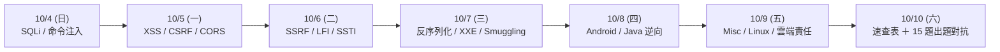

# 🚀 隊員 A 金盾獎初賽 7 天極速衝刺戰略 (10/4 ~ 10/10)
## 「Member A 檢核 ✕ 實戰 Playbook ✕ PortSwigger 學院」三位一體衝刺方案

> **當前時間**：民國 115 年 10 月 4 日（距 10/17 初賽倒數 13 天）  
> **成員定位**：隊員 A（蔣）—— Web 應用安全 ＋ Android/Java 逆向 ＋ Misc/雲端責任模型（1/3 通識）  
> **衝刺目標**：在 10/10 前完成主修領域全面閉環，提煉「一頁紙極速速查表」，產出 15 題全真單選題供小隊交叉對戰！

---

## 🧭 衝刺核心心法：為什麼是「三位一體」？

金盾獎初賽為 **90 分鐘單選題、斷網閉卷、全隊共用 1 台電腦**。平均每題作答時間僅 **54 秒**，絕非現場滲透打靶，而是**「看特徵、抓題眼、秒殺選項」**：

```text
┌────────────────────────────────┐   ┌────────────────────────────────┐   ┌────────────────────────────────┐
│   PortSwigger Web Academy      │   │     本地實戰 Playbook 手冊     │   │      金盾/技能競賽真題剖析      │
│  (理論觀念 / Payload 形態結構) │ + │   (底層機制 / 防護標頭 / 繞過)  │ + │   (題眼抓取 / 誘答選項防陷阱)   │
└────────────────────────────────┘   └────────────────────────────────┘   └────────────────────────────────┘
                                                    ▼
                                    【5 秒內辨識漏洞成因與標準解法】
```

> ⚠️ **重要原則**：
> 1. **PortSwigger Academy 只讀觀念說明 (Explanation)，不要做 Labs！** 讀每頁的 Vulnerability explanation、Payload 形式與 How to prevent。
> 2. **本地 Playbook** 快速掃描 Header 語法、配置錯誤與底層原理。
> 3. **真題手冊** 熟悉考官的出題切入點與典型誘答干擾項。

---

## 📅 7 天極速推進課表 (10/4 ~ 10/10)



---

### 📌 Day 1 (10/4 今晚)：SQL 注入深度 ＋ 寬字節 ＋ OS 命令注入
* **考核重點**：從錯誤訊息辨別資料庫類型、時間盲注函數差異、GBK 寬字節逃逸、命令注入空白替代。

| 學習維度 | 研讀資料與核心動作 | 核心秒殺題眼 / 必背考點 |
| :--- | :--- | :--- |
| **PortSwigger 學院** | • [SQL injection](https://portswigger.net/web-security/sql-injection)<br>• [OS command injection](https://portswigger.net/web-security/os-command-injection) | • **Union 注入**：欄位數 (`ORDER BY n--`) 與型態 (`UNION SELECT 'a', NULL--`)<br>• **命令注入**：常見管道符號 `|`, `||`, `;`, `&`, `&&` |
| **本地 Playbook** | • [`web/R10.1_sql_query_injection.md`](web/R10.1_sql_query_injection.md)<br>• [`web/R10.2_os_command_shell_injection.md`](web/R10.2_os_command_shell_injection.md) | • **延遲函數**：MySQL `sleep(5)`、MSSQL `WAITFOR DELAY '0:0:5'`、PostgreSQL `pg_sleep(5)`、Oracle `dbms_pipe.receive_message`<br>• **寬字節**：GBK 編碼下 `%df%27` ➔ 轉義加斜線變 `%df%5c%27` ➔ `%df%5c` 湊成漢字「運」，單引號逃逸！<br>• **空白繞過**：`${IFS}`, `$IFS$9`, `<`, `<>`, `{cat,flag}` |
| **真題剖析手冊** | • [`exam_analysis_manual.md`](../exam_analysis_manual.md) Q1 (SQLi 根本防禦)<br>• CTF II Web 02 (子題 3 命令注入) | • **防禦根治**：唯一正解是「參數化查詢 (Prepared Statements)」；黑名單與 WAF 均無法根本杜絕 |

- [ ] 完成 Day 1 複習，確認能默寫四家資料庫延遲函數與寬字節 `%df` 原理。
- [ ] 實戰檢定：完成 👉 [**單元一 25 題全真專項檢定卷**](exams/unit_1_exam_25q.md)（目標：答對 22 題以上）。

---

### 📌 Day 2 (10/5 一)：前端攻擊三部曲（XSS ＋ CSRF ＋ CORS ＋ Cookie 旗標）
* **考核重點**：XSS 三種型態區分、CSP Nonce 放行機制、SameSite Cookie 差異、CORS 憑證信任濫用。

| 學習維度 | 研讀資料與核心動作 | 核心秒殺題眼 / 必背考點 |
| :--- | :--- | :--- |
| **PortSwigger 學院** | • [Cross-site scripting (XSS)](https://portswigger.net/web-security/cross-site-scripting)<br>• [Cross-site request forgery (CSRF)](https://portswigger.net/web-security/csrf)<br>• [Cross-origin resource sharing (CORS)](https://portswigger.net/web-security/cors) | • **XSS 分類**：Reflected (參數即時反射)、Stored (資料庫持久化)、DOM-based (前端 JS 處理 `location.search` 寫入 `innerHTML`)<br>• **CSRF**：瀏覽器跨站自動攜帶憑證的特性<br>• **CORS**：`Access-Control-Allow-Origin` 與憑證匹配 |
| **本地 Playbook** | • [`web/R14.1_reflected_cross_site_scripting.md`](web/R14.1_reflected_cross_site_scripting.md)<br>• [`web/R14.2_stored_cross_site_scripting.md`](web/R14.2_stored_cross_site_scripting.md)<br>• [`web/R14.3_dom_based_cross_site_scripting.md`](web/R14.3_dom_based_cross_site_scripting.md)<br>• [`web/R14.4_cross_site_request_forgery.md`](web/R14.4_cross_site_request_forgery.md)<br>• [`web/R14.5_cross_origin_resource_sharing_trust_abuse.md`](web/R14.5_cross_origin_resource_sharing_trust_abuse.md) | • **Cookie 屬性**：<br>  - `HttpOnly`：禁止 JS 讀取 `document.cookie`，防 XSS 偷 Token，**不能**防 CSRF！<br>  - `SameSite=Strict`：完全禁止跨站攜帶；`Lax`：僅允許頂層 GET 導航攜帶；`None`：必須搭配 `Secure`<br>• **CORS 致命配置**：反射請求來源 `Origin: evil.com` 且宣告 `Allow-Credentials: true`<br>• **CSP Nonce**：`<script nonce="...">` 必須隨機且單次有效，防禦內嵌腳本注入 |
| **真題剖析手冊** | • [`exam_analysis_manual.md`](../exam_analysis_manual.md) Q2 (Stored XSS 辨別)<br>• Q3 (CSRF 防禦手段) | • **CSRF 標準解法**：隨機 Anti-CSRF Token、SameSite Cookie、二次驗證碼（CAPTCHA） |

- [ ] 完成 Day 2 複習，確認能一秒說出 HttpOnly 與 SameSite 的防護邊界差異。

---

### 📌 Day 3 (10/6 二)：伺服器端信任濫用（SSRF ＋ LFI/RFI ＋ SSTI ＋ 檔案上傳）
* **考核重點**：SSRF 偽協定與雲端 IMDS 元數據、DNS Rebinding、PHP 偽協定讀源碼、SSTI 模板特徵。

| 學習維度 | 研讀資料與核心動作 | 核心秒殺題眼 / 必背考點 |
| :--- | :--- | :--- |
| **PortSwigger 學院** | • [Server-side request forgery (SSRF)](https://portswigger.net/web-security/ssrf)<br>• [Directory traversal / File path traversal](https://portswigger.net/web-security/file-path-traversal)<br>• [Server-side template injection (SSTI)](https://portswigger.net/web-security/server-side-template-injection)<br>• [File upload vulnerabilities](https://portswigger.net/web-security/file-upload) | • **SSRF 雲端標靶**：`http://169.254.169.254/latest/meta-data/` (AWS/GCP 元數據)<br>• **SSTI 辨識樹**：`${7*7}` (Java EL/FreeMarker) vs `{{7*7}}` (Jinja2/Twig)<br>• 測試 `{{7*'7'}}`：輸出 `7777777` 表 Jinja2；輸出 `49` 表 Twig |
| **本地 Playbook** | • [`web/R11.1_server_side_request_forgery.md`](web/R11.1_server_side_request_forgery.md)<br>• [`web/05.4_s3_bucket_leak_imds_ssrf_defense.md`](web/05.4_s3_bucket_leak_imds_ssrf_defense.md)<br>• [`web/R11.2_file_path_traversal.md`](web/R11.2_file_path_traversal.md)<br>• [`web/R11.3_local_file_inclusion.md`](web/R11.3_local_file_inclusion.md)<br>• [`web/R11.4_remote_file_inclusion.md`](web/R11.4_remote_file_inclusion.md)<br>• [`web/R10.3_server_side_template_injection.md`](web/R10.3_server_side_template_injection.md) | • **SSRF 偽協定**：`gopher://`（自訂任意 TCP 數據包打 Redis/FastCGI）、`dict://`<br>• **DNS Rebinding**：利用 DNS 伺服器回傳 TTL=0，兩次解析切換（外網 IP 繞過 ➔ 127.0.0.1 攻擊）<br>• **PHP 偽協定**：`php://filter/read=convert.base64-encode/resource=xxx.php`（無執行環境時讀檔）<br>• **Nginx alias 目錄穿越**：`location /img { alias /var/www/image/; }` 若缺少結尾斜線，訪問 `/img../` 導致目錄遍歷 |
| **真題剖析手冊** | • [`exam_analysis_manual.md`](../exam_analysis_manual.md) CTF II Web 03 (SSTI 提取結構體變數) | • **Golang 模板注入**：`{{printf "%+v" .}}` 印出內部結構體與敏感欄位 |

- [ ] 完成 Day 3 複習，掌握雲端 IMDS IP `169.254.169.254` 與 Jinja2/Twig 辨識矩陣。

---

### 📌 Day 4 (10/7 三)：深層語意與狀態架構（反序列化 ＋ XXE ＋ JWT ＋ 請求走私）
* **考核重點**：PHP 魔術方法、Java readObject/Log4Shell、XXE SYSTEM 宣告、JWT 演算法混淆、HTTP 走私 CL.TE/TE.CL。

| 學習維度 | 研讀資料與核心動作 | 核心秒殺題眼 / 必背考點 |
| :--- | :--- | :--- |
| **PortSwigger 學院** | • [Insecure deserialization](https://portswigger.net/web-security/deserialization)<br>• [XML external entity (XXE) injection](https://portswigger.net/web-security/xxe)<br>• [JSON Web Token (JWT) attacks](https://portswigger.net/web-security/jwt)<br>• [HTTP request smuggling](https://portswigger.net/web-security/request-smuggling) | • **反序列化標記**：PHP `O:4:"User":...`、Java `rO0AB` (Base64 魔術字節 `0xACED`)<br>• **XXE 實體**：`<!ENTITY xxe SYSTEM "file:///etc/passwd">`<br>• **JWT 結構**：`Header.Payload.Signature`<br>• **請求走私**：前端與後端對 `Content-Length` 與 `Transfer-Encoding: chunked` 解析不一致 |
| **本地 Playbook** | • [`web/R12.1_unsafe_deserialization_object_injection.md`](web/R12.1_unsafe_deserialization_object_injection.md)<br>• [`web/20.1_java_memshell_filter_servlet_forensics.md`](web/20.1_java_memshell_filter_servlet_forensics.md)<br>• [`web/R12.2_xml_external_entity_processing_abuse.md`](web/R12.2_xml_external_entity_processing_abuse.md)<br>• [`web/R09.1_application_session_state_forgery_validation_bypass.md`](web/R09.1_application_session_state_forgery_validation_bypass.md)<br>• [`web/R13.1_http_request_smuggling_desynchronization.md`](web/R13.1_http_request_smuggling_desynchronization.md)<br>• [`web/16.4_http_request_smuggling_defense.md`](web/16.4_http_request_smuggling_defense.md) | • **PHP 反序列化魔術方法**：<br>  - `__destruct()`：物件銷毀時執行（最常見入口）<br>  - `__wakeup()`：反序列化重建時執行<br>  - `__toString()`：物件被當作字串輸出時觸發<br>• **JWT 攻擊手冊**：<br>  - `alg: "none"` 繞過<br>  - **RS256 轉 HS256 演算法混淆**（利用公開公鑰字串作為 HS256 的對稱金鑰簽名）<br>• **XXE 根本防禦**：禁用外部 DTD 實體解析（`disallow-doctype-decl`） |
| **真題剖析手冊** | • [`exam_analysis_manual.md`](../exam_analysis_manual.md) CTF II Web 01 (Redis 竄改 Session 反序列化)<br>• CTF II Web 02 (HeapDump 提取 JWT 金鑰) | • **Session 序列化特徵**：竄改字串時必須同步修正長度，如 `s:5:"admin"`，長度不符則解析失敗 |

- [ ] 完成 Day 4 複習，能精準解釋 JWT RS256 ➔ HS256 混淆成因與 HTTP 走私 CL.TE 原理。

---

### 📌 Day 5 (10/8 四)：Android / Java 逆向工程專題
* **考核重點**：APK 目錄架構、AndroidManifest.xml、Smali 語法特徵、jadx vs apktool vs Frida 職責分工、ProGuard 混淆。

| 學習維度 | 研讀資料與核心動作 | 核心秒殺題眼 / 必背考點 |
| :--- | :--- | :--- |
| **官方考綱定位** | • 初賽完全「不考動態撰寫 Frida 腳本」，只考**「讀懂 Smali 代碼」**與**「工具對應」** | • **APK 四大元件**：Activity (畫面)、Service (背景服務)、Broadcast Receiver (廣播接收)、Content Provider (資料共享) |
| **本地 Playbook** | • [`android/26.1_android_apk_malware_static_decompilation.md`](android/26.1_android_apk_malware_static_decompilation.md)<br>• [`android/26.2_android_runtime_logs_sqlite_forensics.md`](android/26.2_android_runtime_logs_sqlite_forensics.md) | • **APK 檔案結構**：<br>  - `AndroidManifest.xml`：四大元件、權限與 `android:debuggable` 旗標<br>  - `classes.dex`：Dalvik 位元組碼（Java 編譯後產物）<br>  - `lib/`：Native 函式庫（包含各 CPU 架構 `.so`）<br>  - `resources.arsc`：二進位資源索引<br>• **Smali 關鍵指令**：<br>  - `const/4 v0, 0x1`（常數賦值）<br>  - `invoke-virtual` / `invoke-static`（方法呼叫）<br>  - `if-eqz v0, :cond_0`（若為 0 則跳轉）<br>  - 型態標記：`Z`=boolean, `I`=int, `V`=void, `Ljava/lang/String;`=字串物件 |
| **四大工具分工** | • **`jadx / jadx-gui`**：DEX 反編譯為高階 Java 程式碼（副檔名 `.java`）<br>• **`apktool`**：解包資源並反組譯為 Smali 組合語言（`apktool d`），修改後重打包（`apktool b`）<br>• **`Frida`**：動態程式碼插樁 (Hooking)，執行時期攔截函式、修改返回值、繞過 SSL Pinning<br>• **`ProGuard / R8`**：Java 程式碼混淆器（將類別/方法改為 a, b, c，移除除錯資訊） | • 題目給一段組合語言問屬於哪種中介碼：看到 `invoke-virtual`、`move-result-object` ➔ **Smali**！ |

- [ ] 完成 Day 5 複習，確認能分清 jadx 與 apktool 輸出產物差異，並看懂基本 smali 跳轉。

---

### 📌 Day 6 (10/9 五)：隊員 A 負責之 Misc ＋ Linux 權限 ＋ 雲端責任模型
* **考核重點**：Linux 權限三位數字與 SUID/SGID、常用 14 個 Port 號、IaaS/PaaS/SaaS 劃分、ZIP 偽加密與 PNG 隱寫。

| 學習維度 | 研讀資料與核心動作 | 核心秒殺題眼 / 必背考點 |
| :--- | :--- | :--- |
| **Linux 權限與指令** | • [`misc_cloud/R18.1_linux_suid_sgid_binary_abuse.md`](misc_cloud/R18.1_linux_suid_sgid_binary_abuse.md) | • **基本權限**：`r=4`, `w=2`, `x=1`。`chmod 755` ➔ 7 (rwx) / 5 (r-x) / 5 (r-x)<br>• **特殊位元**：<br>  - **SUID (`4000`, `rwsr-xr-x`)**：執行者臨時獲得擁有者權限（如 `/bin/passwd`、GTFOBins 提權）<br>  - **SGID (`2000`, `rwxr-sr-x`)**：目錄下新增檔案繼承該目錄所屬群組<br>  - **Sticky Bit (`1000`, `rwxrwxrwt`)**：僅擁有者與 root 可刪除檔案（如 `/tmp`） |
| **常用通訊埠 (Ports)** | • 必背速查清單 | • `21`: FTP（明文，20 為資料埠）<br>• `22`: SSH / `23`: Telnet（明文）<br>• `25`: SMTP / `110`: POP3 / `143`: IMAP<br>• `53`: DNS（預設 UDP；AXFR 區域傳送為 TCP）<br>• `80`: HTTP / `443`: HTTPS<br>• `161`: SNMP（UDP） / `389`: LDAP / `636`: LDAPS<br>• `445`: SMB（EternalBlue MS17-010）<br>• `3306`: MySQL / `1433`: MSSQL / `3389`: RDP |
| **雲端共同責任模型** | • [`misc_cloud/05.1_cloud_shared_responsibility_matrix.md`](misc_cloud/05.1_cloud_shared_responsibility_matrix.md) | • **IaaS**：雲廠商管實體機房與硬體虛擬化；**客戶管 OS、修補、防火牆、應用與資料**<br>• **PaaS**：雲廠商管 OS 與 Runtime；**客戶管應用程式代碼與資料配置**<br>• **SaaS**：雲廠商管整套系統；**客戶管身分存取 (IAM) 與帳號授權** |
| **Misc 隱寫要點** | • ZIP 偽加密與 PNG 結構 | • **ZIP 偽加密**：修改壓縮目錄區全域方式位標記（修改為 `09 00` 假裝有密碼，改回 `00 00` 即可解開）<br>• **PNG 結構**：Magic Header `89 50 4E 47 0D 0A 1A 0A`；`IHDR` Chunk 被惡意修改「高度」隱藏 flag，需用 CRC32 校驗碼逆推正確高寬 |

- [ ] 完成 Day 6 複習，閉眼手算任意 chmod 權限，並背熟 14 大通訊埠與雲端責任邊界。

---

### 📌 Day 7 (10/10 六)：衝刺閉環——速查表整理 ＋ 15 題全真單選題出題
* **今日任務**：
  1. 產出 **「隊員 A 一頁紙極速速查表 (Cheat Sheet)」**（收錄所有易混淆點與公式）。
  2. 依據過去 6 天研讀內容，親自出 **15 道全真單選模擬題**（含題目、四個選項、正確答案與解析），準備於 10/11 與隊員 B、C 交叉模擬作答！

#### 📝 隊員 A 出題配比建議 (15 題)：
- **Web 領域 (9 題)**：
  - SQLi 延遲函數或寬字節 (1 題)
  - XSS 與 CSP nonce (1 題)
  - CSRF 與 SameSite/HttpOnly 屬性 (1 題)
  - CORS 設定錯誤 (1 題)
  - SSRF 與雲端元數據/DNS Rebinding (1 題)
  - SSTI 辨識 (1 題)
  - LFI/PHP 偽協定 (1 題)
  - 反序列化/XXE (1 題)
  - JWT 演算法混淆或 HTTP 走私 (1 題)
- **Android / Java 逆向 (3 題)**：
  - APK 結構與 AndroidManifest 四大元件 (1 題)
  - Smali 語法或 DEX/so 辨識 (1 題)
  - 工具職責 (jadx vs apktool vs Frida vs ProGuard) (1 題)
- **Misc 與網路通識 (3 題)**：
  - Linux SUID/SGID 特殊權限 (1 題)
  - 常用 Port 號辨識 (1 題)
  - 雲端 IaaS/PaaS/SaaS 共同責任劃分 (1 題)

---

## ⚡ 隊員 A 考場 5 秒「秒殺答題」直覺對照表

| 當題目題目或選項出現以下關鍵字... | 正確答案直覺反射 |
| :--- | :--- |
| 「下列何者能**根本防範** SQL 注入？」 | ➔ 秒選 **參數化查詢 (Prepared Statements)** |
| 看到 SQL payload 出現 `%df'` 或 `%df%5c%27` | ➔ 秒選 **寬字節注入 (GBK 雙位元組編碼)** |
| 延遲函數：`sleep(5)` vs `WAITFOR DELAY` vs `pg_sleep` | ➔ 秒判 **MySQL vs MSSQL vs PostgreSQL** |
| 「防止 JavaScript 讀取 Cookie 竊取 Session」 | ➔ 秒選 **HttpOnly 旗標**（注意：HttpOnly 不能防 CSRF！） |
| 「防範 CSRF 跨站請求偽造」 | ➔ 秒選 **SameSite=Strict/Lax**、**Anti-CSRF Token**、**驗證碼** |
| 「CORS 允許跨站讀取敏感回應的配置漏洞」 | ➔ 秒選 **反射 Origin ＋ `Allow-Credentials: true`** |
| 「SSRF 存取雲端執行個體元數據 (Metadata)」 | ➔ 秒選 **`169.254.169.254`** |
| 「PHP 在不具備執行環境下讀取原始碼」 | ➔ 秒選 **`php://filter/read=convert.base64-encode/resource=...`** |
| 模板語法測試 `{{7*'7'}}` 輸出 `7777777` | ➔ 秒選 **Jinja2 模板引擎** |
| 命令注入繞過空白過濾 | ➔ 秒選 **`${IFS}`** 或 **`<`** |
| JWT 弱點：公鑰被當作對稱金鑰簽名 | ➔ 秒選 **RS256 轉 HS256 演算法混淆** |
| XXE 外部實體宣告 | ➔ 秒選 **`<!ENTITY x SYSTEM "...">`**；防禦為 **禁用 DTD 外部實體** |
| 「何者**不是** Web 漏洞或掃描工具？」出現 `gflags` | ➔ 秒選 **`gflags`**（它是 Windows 系統除錯工具！） |
| Android 二進位位元組碼檔案 | ➔ 秒選 **`classes.dex`** |
| 將 APK 反編譯為可讀的 `.java` 原始碼 | ➔ 秒選 **`jadx`**（若為反組譯 smali 則是 `apktool`） |
| 動態 Hooking 注入、繞過 SSL Pinning | ➔ 秒選 **`Frida`** |
| Linux 權限看到 `rwsr-xr-x`（擁有者有 `s`） | ➔ 秒選 **SUID（數值 4000）**，執行時具有擁有者權限 |
| 「作業系統修補與防火牆屬於客戶之責任」 | ➔ 秒選 **IaaS (基礎設施即服務)** |
